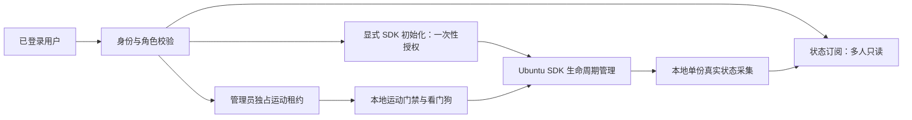

# SDK 分段计时诊断与连接／读取／运动权限分离方案

状态：诊断源码已在本地实现，现场部署待固定候选审阅；权限分离为设计方案，尚未实施。当前线上805921eeb03285b8，真实SDK稳定性未通过。用户本轮要求先做诊断、不放宽超时限制；允许考虑延长单次续期有效期，具体范围在第7节区分。

## 1. 已确认的问题与边界

11月2日10:32的新Observer会话授权确认22.728秒后释放，云端续期序号88；Ubuntu最后成功renew后到期。没有初始化SDK，因此不能把这轮故障直接归因于SDK库。此前有真实TCP下行重传证据，但本次故障未采集同一窗口的完整分段时序。失败日志原elapsedMs包含等待撤销/停止回执，不能等同纯网络往返时间。

本地context接口事后60次补测最大2.39ms，NTP同步正常，不能排除故障瞬间的本机停顿。读到ALREADY_STOPPED或进程退出不证明独立硬件安全停止。

本轮不改500ms浏览器新鲜度、1000ms签名及本地看门狗、1500ms设备租约ACK等待、最多4条在途续期、readOnly运动门禁；不发送初始化或后续运动，仅申请sdk范围授权收集计时即可。

## 2. 分段诊断实现

| 段 | 插桩位置 | 记录内容与解释 |
|---|---|---|
| 云端调度 | cloud-api/src/control/leases.js | 排队、出队、身份校验完成、准备检查完成、数据库续期完成、签发、dispatch返回、ACK到达／失败；ACK计时在等待撤销之前完成 |
| 云端中继 | device-relay/src/server.js | 注册复核完成、ws.send入队、写回调、ACK到达／超时／关闭；写回调仅表示本机写入完成，不表示设备收到 |
| Ubuntu接收 | edge-agent/.../bound_transport.py | ws.recv返回、任务开始、验签完成、等待锁、取得锁、本地HTTP返回、回复发送返回 |
| 汇总 | tools/operations/summarize_sdk_timing.py | 以摘要关联三段，输出各阶段p50/p95/max、完整／缺失关联数与结果计数；缺失阶段不填0 |

使用现有签名载荷的base64url原始字符串SHA256作匿名关联摘要；不添加协议字段，不记录原始载荷、签名、请求ID、用户ID、设备ID、邮箱、令牌或关节数据。摘要仅用于关联，不能授权或重放。只跟踪scope=sdk的lease_renew，其他命令不跟踪。云端签发前失败的记录没有摘要，单独计数。

同进程耗时使用单调时钟。日志同时保留墙钟时间以辅助跨机对齐，但“Ubuntu接收时间－云端发送时间”含时钟偏差、TLS／代理／socket排队，报告明确标为估计值，不能直接宣布它是单向网络延迟。NTP同步yes也不等于两台机器零偏差。

诊断开关THIRDHAND_SDK_TIMING=1，默认关闭。每个记录器从首条相关续期开始最多600秒、12000条，先达到任一即停止；进程重启会重新建立计数，所以试验结束必须撤销临时开关。输出已有服务journal，不增加数据库表、网络端口或上报接口。日志sink抛异常不能中断授权或撤销；限量仍有额外开销，实测须检查日志量和服务负载。

局限：本地HTTP往返暂作为一段，若它异常才细分Robot Node策略与Python worker；未增加抓取完整HTTP载荷的操作。浏览器到云端仍使用既有fresh/stale结果，本轮主要定位已确认的设备续期到期；若出现browser_stale应另立浏览器分段，不能用设备诊断替代。窗口开始前和结束后核对两端时间同步状态。

## 3. 现场执行与判读

1. 固定云端3件源码（leases.js、server.js、新lease-timing.js）及Ubuntu2件（bound_transport.py、新lease_timing.py），核对当前有效服务路径和完整基线。复制新发布／代理快照，保留其他任务源码。只在零租约、零在途命令、SDK未连接时切换。
2. 短时启用两端计时开关，按审阅重启业务API与代理；Robot服务不改源码或启动路径。代理重启可能短暂影响相机/采集子进程，恢复后核验。
3. Observer登录一次，只申请SDK授权，不点连接。保持页面前台，采集同一窗口。最多3次有界授权试验，每次终止后核对设备无有效租约；不自动重试连接或初始化。任一试验有足够完整失效链即可停止，不为凑次数重复。
4. 提取仅component=sdk_segment_timing的结构化记录，离线汇总。原始业务journal不能整段上传；认证字段和HTTP载荷不采集。
5. 判读：云端出队/DB慢则检查其等待；中继注册/写回调慢则查对应服务；Ubuntu task/lock慢则查本地排队；本地HTTP慢再细分Robot服务；三端本地处理均快但跨段等待大时再做TCP元数据或网络路径对照。没有对应时间窗证据不直接归因校园网。
6. 撤销临时开关，核对恢复默认关闭、服务健康、SDK仍断开。保留摘要统计和必要匿名事件，文档标明真实授权诊断与合成测试。此项不能代替SDK初始化后的10分钟真实状态验收。

## 4. 为什么要分离

现有platform/storage/src/leases.js用会话模式决定sdk/control范围，并共用ops.control_leases；services/robot/src/control-policy.js仅保留一个lease，任何范围到期都会stop；Python startouch_bridge.py的_remote_lease_expired会disconnect。也就是说，SDK连接、状态读取与控制续期仍共用失效处理。

目标是把三种能力拆开，而不是删除保护：

SDK“已连接”不是电机已安全停止，也不是当前有运动权限；这三个状态必须分别展示。

## 5. 权限、状态与操作流程

| 能力 | Observer／管理员观察模式 | Administrator＋MFA |
|---|---|---|
| 订阅真实状态、相机、完整运行记录 | 允许；每个HTTP/WS会话独立鉴权 | 允许 |
| 显式初始化SDK | 允许；同一设备串行，说明使能与默认闭爪副作用 | 同样规则，不自动获得运动权 |
| 修改模型／个人模型点位 | 允许，只影响仿真 | 允许；模型编辑也不默认发送真机 |
| 获取运动控制权／运动／语音／真机点位 | 拒绝 | 需要有效独占运动租约及所有本地门禁 |
| 退出状态订阅 | 只退出本人订阅，不关闭他人的SDK | 同样规则 |
| 断开设备SDK | 仅初始化发起者可在无运动占用时显式申请；其他观察员只退出本人订阅；有运动／未知停止状态时拒绝普通断开 | 经明确停止流程和证据检查后断开；不绕过本地门禁 |
| 强制接管 | 拒绝 | 提示后确认，旧租约失效且停止状态确认后新租约才能生效 |

管理员登录本身不占运动权，多名管理员可查看页面；同设备只能有一份有效运动租约。管理员在Observer模式没有运动权。角色回收、登出、会话过期立即撤销该会话的订阅与运动权；其他合法观看者不受连带退出。

SDK生命周期建议：disconnected → initializing → connected；异常进入fault或disconnecting；初始化结果不明进入unknown，禁止自动重试。多个用户同时点连接时只允许一次初始化，其余返回“正在连接”或“已连接”；不能再次闭爪。以设备generation和commandId持久化去重，重启后先核对未知结果，不能重新执行旧命令。

一次性入场授权不代表初始化可以无限运行：初始化任务还需独立的执行时限和取消/失联处理，时限由SDK实测确定；入场有效期与任务执行时限分开。若SDK阻塞调用无法确认取消，进入unknown并禁止新的初始化或运动，不用“超时后再试一次”处理。初始化过程中是否能可靠取消和保持读取属于D3的验收前置条件，本轮不改变现有初始化门禁。

状态订阅建议：waiting／fresh／stale／offline／read_error，并展示采样时间、年龄、字段可用性。保留C8最新状态缓存、独立采集与历史上传；真实数据与Three.js模拟数据分开，不自动覆盖用户模型。每次重连只恢复获准订阅，不恢复运动租约或SDK初始化。

运动状态建议：unavailable／available／requesting／owned／occupied／revoked／stop_unknown。无权、过期、旧generation、旧序号、非管理员、状态过期均在服务器与Ubuntu同时拒绝。软件停止结果不明时禁止接管、初始化及新运动，现场处理前保持门禁。

关键限制：在SDK持续使能时停止运动而保留读取，需要确认SDK能独立停止所有运动入口，且停止不会断开读取。如果目前只有disconnect可用，则运动租约失效仍保持现有断开策略；仅先分离网页状态订阅，不能为了“保持在线”移除disconnect。物理看门狗、急停与控制器停止能力须单独验证。

## 6. 模块、接口与数据库具体改动（待实施）

| 层 | 改动 |
|---|---|
| 身份策略 | platform/identity/src/policy.js保留两种角色；新增内部能力sdk.initialize、sdk.detach、state.subscribe，与control.command严格区分；所有旧接口仍鉴权，不能留兼容旁路 |
| 云端生命周期 | 新建sdk-lifecycle服务，将显式连接／断开、commandId幂等、单设备并发锁、generation与初始化结果管理从control/leases拆出 |
| 云端运动 | control/leases.js只管理管理员独占运动权；数据库不能再仅凭登录mode在申请SDK时隐式分配control范围 |
| 网关 | bound_transport.py/command_gate.py识别版本化的一次性初始化授权和运动租约；旧消息默认继续原门禁，未知purpose/scope拒绝 |
| Robot Node／Python | control-policy.js、remote_lease_guard.py、startouch_bridge.py分别维护生命周期与运动门禁；所有运动入口枚举审计，持续动作每轮检查运动租约；先验证停止能力再改变到期清理 |
| 前端 | device-state.js、admin-control.js将“连接SDK”“状态订阅”“申请运动控制”独立展示；两种布局、中英文保持一致；过期不显示假连接成功 |
| 数据库 | 新增ops.sdk_lifecycle_commands（commandId、device/generation、actor/session、kind、状态、requested/started/finished时间、resultCode）；新增ops.sdk_lifecycle_events记录真实状态变化；必要时ops.sdk_connection_state仅作最近报告缓存，不作为硬件权威 |
| 现有表 | ops.control_leases现有sdk范围历史保留，增加版本字段后新运动只写control范围；不重写旧记录。历史robot_samples及运行记录导出继续复用 |

建议新API（名称待接口最终核对）：POST /api/devices/:id/sdk/initialize、POST /api/devices/:id/sdk/disconnect、GET /api/devices/:id/sdk/status；运动使用现有control租约API并明确返回capabilities；状态继续复用C8鉴权API，不新造采集通道。

初始化请求包含commandId与当前deviceGeneration，响应202＋状态查询地址；相同commandId只能读取原结果，不能重做副作用；不同commandId遇initializing返回409。过期／失联后返回unknown，由设备状态与人工明确恢复，不在浏览器重连时重复发送。

数据库角色最小授权：业务账号仅新增必要表的SELECT/INSERT/UPDATE，不给DDL；迁移由部署角色执行。设备凭据不能查询成员表或修改用户角色。管理员页面查看生命周期事件、运动租约和真实采样并可按已有权限导出；观察员只能查看允许的机械臂记录，不获得成员数据。

发布顺序：向后兼容迁移 → 支持新旧协议但默认旧行为的Ubuntu → 云端新API → 前端入口 → 验收后逐设备启用新行为。回退关闭新功能开关、恢复旧行为，新表与历史数据保留；不在有活动运动或未知停止时切换协议。

## 7. 单次续期时长的处理

“续期间隔”“单次租约有效期”“等待ACK超时”是不同参数。增大单次有效期会延长失联后本地仍视为有效的最长时间，仍属于该类授权的失效阈值变化，不能只改云端一个数字。

| 参数 | 本轮诊断 | 后续建议 |
|---|---|---|
| 浏览器运动新鲜度 | 500ms不变 | 不随只读连接调整 |
| 当前sdk/control签名、本地看门狗、DB续期 | 1000ms不变 | 完成能力分离前不延长共用租约 |
| 云端设备租约ACK等待 | 1500ms不变 | 根据实测与未决请求上限独立评审 |
| 状态订阅／只读连接保持有效期 | 暂无独立参数 | 分离完成后可比较2s／3s候选，仅影响读取保持与清理，不授权初始化重试或运动 |
| 管理员运动租约／命令有效期 | 不变 | 本轮不延长，运动恢复不自动续接 |

2s／3s是待实测的候选，不是已批准上线值。若诊断显示停顿远超此范围，延长会掩盖链路问题，不能承诺稳定。若最终采用，必须同步更新签名验证、DB、网关和本地guard的明确scope上限，以及重放／过期边界测试；禁止全局把1000改3000。一次性初始化授权仍按原短期入场校验，长订阅不复用为动作授权。

## 8. 验收与交付阶段

1. D1：完成分段诊断源码、合成延迟测试、数据泄露边界测试、固定包和回退。独立批准现场部署后采集真实授权时序；本阶段不初始化SDK。
2. D2：依据D1证据选择针对性修复，必要时做网络路径对照。优先改证实的排队／阻塞点。
3. D3：先分离多用户状态订阅和显式SDK初始化；保持现有运动失效断开规则。验证并发初始化只执行一次、重连不闭爪、过期旧数据不展示为实时、账户撤销生效。
4. D4：独立运动租约与本地看门狗；满足停止能力前置条件后才考虑“停止运动但保持读取”。用户现场授权、人员看护和明确范围下验收真实动作。
5. D5：评审仅用于读取保持的2s／3s有效期；分别比较断线恢复和授权撤销窗口，不改变运动门禁。

自动化：合成DB慢、注册慢、ACK慢、Ubuntu锁慢、本地HTTP慢；校验分段定位、乱序ACK、诊断异常不影响撤销、默认关闭、600秒/12000条封顶、完整摘要关联、日志不含敏感字段。SDK初始化同时点击、重复commandId、服务重启结果unknown、观察员构造运动请求、管理员Observer模式、角色撤销、旧generation重放均应有拒绝断言。

真实验收：诊断部署后先取得可解释的完整失败／稳定窗口；后续SDK连接至少连续10分钟真实状态、关节单位/夹爪字段与源端一致；模拟数据测试与真实验收分别记录。拔网/会话撤销不得自动恢复运动，不将API成功或SDK进程退出当作物理停止证据。
