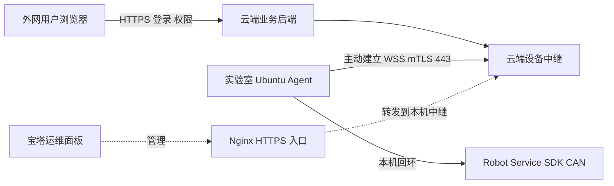

# ThirdHand 校园网与宝塔设备网关部署说明

日期：2026-10-29。状态：设计与配置说明，未安装、未应用服务器配置、未连接 SDK。

配套方案：[公网部署与账号权限数据库设计 v0.4.1](2026-10-29-public-access-roles-database-design.md)。新手教程由队友开发，本任务只预留登录后跳转和接口适配，合并时完成连接，不重复开发教程或维护另一份进度数据库。

## 1. 网关是什么

这里有三个不同服务：

- 宝塔是云服务器的运维面板，用来管理 Nginx、网站、进程、证书和数据库；业务用户不使用宝塔账号登录。
- 云端设备中继是需要开发、部署在云服务器上的程序，识别设备证书、维护设备连接，并转发经过权限和控制权检查的消息。
- Ubuntu 设备 Agent 是需要开发、部署在实验室电脑上的后台服务，主动连接云端中继，验证命令，再调用本机 Robot Service。它负责心跳、本地去重、状态缓冲和失联处理。

当前静态站点和宝塔并不等于这些程序已经存在并通过验收。配置域名、Nginx 反向代理，只是让连接能抵达云端程序；还不能直接产生安全的真机远控能力。



Ubuntu 主动发起连接后，通道可以双向收发。管理员的命令通过已有连接返回 Ubuntu，并不要求云服务器主动拨入校园内网。

关键区别：宝塔上反向代理的上游应是**云服务器本机的设备中继**，例如 `127.0.0.1:3201`，不能直接填实验室的 `192.168.58.68:9983`。后者是内网地址，普通公网服务器不能据此访问校园电脑。

## 2. 本次已看到什么，尚未验证什么

### 2.1 云端只读观察

| 项目 | 2026-10-29 观察 |
|---|---|
| 宝塔运维入口 | 用户指定的 `https://47.94.95.244:35399/`，已能读取现有登录标签页 |
| 系统与资源 | 面板显示 Ubuntu 22、2 核 CPU、约 1.6 GB 内存，39 GB 磁盘 |
| Web 服务 | Nginx 1.28.3 |
| 已有站点 | `uiea-thirdhand.com`，目录 `/www/wwwroot/uiea-thirdhand-static` |
| 站点 SSL | 宝塔列表显示“未部署” |
| 主域公开 DNS | A 记录为 `47.94.95.244` |
| 设备子域公开 DNS | `edge.uiea-thirdhand.com` 返回 NXDOMAIN，尚无可用解析 |
| 当前 Windows 网络测试 | 云服务器 80/443 可建立 TCP；HTTP 主域首页返回 200；HTTPS 主域握手失败 |
| 设备中继与 Agent | 未安装或配置本方案的程序，不声称目前已有可测试的正式接口 |

面板自身使用 HTTPS，不表示业务域名已配置 HTTPS。端口 443 能建立 TCP，也不表示域名、证书和 WSS 中继已经正确。

目前资源可先做静态站点和无硬件联通验证；不应在未压测情况下承诺它能同时承担数据库、视频中继和长期原始运行数据。以主方案的 10 Hz、全天运行、90 天、每条净载荷 500 字节为例，单设备净载荷约 38.88 GB，已接近整块 39 GB 系统盘，还没有计入系统、索引、WAL 和备份。最终按真实运行时长与频率核算，不能以这个算例推定必须购买某个固定规格。

### 2.2 Tailscale 设备与校园侧首轮实测

用户确认 `100.85.63.78` 是连接机械臂的 Ubuntu。已在指定 Tailscale 控制台看到设备名 `ubuntu`、在线状态 Connected、共享设备状态 Shared in、Linux 内核 `6.14.6-custom`。以原 SSH 账号和原有受信任主机密钥校验成功登录，未修改 Tailscale 访问控制、SSH 或设备配置。后续运维优先使用 Tailscale 地址，不依赖变化的校园 LAN 地址。

从这台 Ubuntu 执行的只读探测结果：

| 校园 Ubuntu 检查 | 结果 |
|---|---|
| `uiea-thirdhand.com` 解析 | `47.94.95.244` |
| `edge.uiea-thirdhand.com` 解析 | 未找到域名 |
| `47.94.95.244:80` | TCP 可连接 |
| `http://uiea-thirdhand.com/` | HEAD 返回 200 |
| `47.94.95.244:443` | Connection refused，连接被拒绝 |
| `https://uiea-thirdhand.com/` | 连接被拒绝，未完成 HTTPS |

说明校园机器具备访问该公网主机 HTTP 的能力，但当前没有验证通过 TLS/WSS。较早 Windows 侧 443 能建立 TCP，Ubuntu 侧则拒绝，不能未经进一步对比就断定是同一个云端故障或校园限制；先核对实际 443 监听、源地址相关安全组/防火墙和证书，再复测校园出口。一次 SSH 超时后重试恢复，长连接稳定性、视频和远控仍需独立测试。

Windows 最初 DNS 查询出现代理测试地址，已用公开 DNS 和 Ubuntu 解析交叉核对。Tailscale 在线只说明该运维连接可建立，不能替代业务网关验证，也不会自动把机械臂开放到公网。

## 3. 校园网是否允许这套方式

通常可行的前提是 Ubuntu 能像普通客户端一样，主动访问云端域名的 TLS/WSS 443，并持续维持连接；不要求实验室有固定公网 IPv4、开放入站端口或在学校路由器做端口映射。以下条件需要从 Ubuntu 实测：

| 校园网络情况 | 对部署的影响与处理 |
|---|---|
| 普通 NAT、私网 IP、共享公网出口 | 一般不妨碍主动出站 WSS；不依赖云端访问实验室内网 IP |
| 要网页认证、定时掉认证或绑定特定登录用户 | 要确认后台系统服务在无人打开浏览器时能否联网；与网管确认正规长期接入方式 |
| HTTPS 能访问，WebSocket Upgrade 被拦 | 页面可打开但 Agent 不可用；需允许目标域名的 WSS，不能只做 curl 首页测试 |
| TLS 代理检查、替换证书、限制客户端证书 | 可能影响端到端 mTLS；需由网管批准目标域名策略，不能关闭证书校验或私自绕过出口控制 |
| 长连接空闲超时 | 配置传输层 ping/pong 与合理反代超时，验证是否稳定；不能因此无限延长真机控制权 |
| 禁止 UDP | 控制 WSS 可能仍可用；视频需测试 TURN/TLS 等合法兼容路径和实际延迟 |
| 校园晚上断网、系统休眠或网卡省电 | 需要监控与重连；远控失联按本地策略停止，恢复网络不恢复运动 |
| 上行带宽低、抖动大 | 降低经过批准的视频码率并压测；若不满足控制与停止指标，先只开放观察和模拟 |

“电脑能打开一个网页”是初步条件，不能证明系统服务、双向认证、长连接和视频都可用。第一阶段应只建立网络探针，发送随机序号和 ping/pong；不连接 SDK、不上传相机、不执行动作。

## 4. 云端在宝塔里怎么配置

以下是计划中的配置步骤，需在正式部署授权后执行。本次没有在宝塔中点击保存、申请证书、修改防火墙、创建数据库或安装程序。

### 4.1 域名与证书

1. 主域 `uiea-thirdhand.com` 已解析到现有服务器，保留展示站。
2. 在域名服务商新增 `edge.uiea-thirdhand.com` 的 A 记录，指向 `47.94.95.244`。IPv6 AAAA 只有服务器和校园路径确实支持时才增加，不照搬不明 IPv6 地址。
3. 宝塔“网站”中为主域和设备子域分别核对站点、域名绑定和 SSL。申请、安装有效域名证书并确认自动续期；先通过 HTTPS 访问验证再启用正式 WSS。
4. 主域普通浏览器使用常规 HTTPS。设备子域额外验证客户端证书；不在整个主域开启强制设备证书，避免把普通用户登录也挡住。

面板 35399 是运维端口，不是设备连接端口。无需为 Agent 开放宝塔账号，也不需要在校园网放行 35399。运维入口按管理员访问策略保护，与业务网站账号分开。

### 4.2 业务服务与私有数据库

建议云端业务 API 和设备中继分别只监听本机/私有网络，例如业务 API `127.0.0.1:3200`、设备中继 `127.0.0.1:3201`；这是拟用端口，不表示当前有这些进程。

通过宝塔的 Node 项目管理或受控 systemd 服务启动已审查的程序，设置日志、重启策略和资源限制。无需因为当前站点位于 PHP 分类就重写为 PHP。PostgreSQL 放在私有网络或本机，只由业务服务访问；Ubuntu Agent 不直连数据库，也不保存数据库口令。

云安全组与服务器防火墙都要核对：用户和设备通常访问 443，80 可用于跳转或证书验证；不公开 3200、3201、3000、3004、3100、8766 或 PostgreSQL 5432。当前 443 的 TCP 测试成功，只证明当时到该 IP 的 TCP 路径可达，不替代这些策略检查。

### 4.3 反向代理与 WSS

在宝塔相应站点的反向代理配置中，将设备路径转发到云服务器自己的中继，启用 WebSocket。Nginx 需要传递 Upgrade / Connection，并设置 HTTP/1.1 与超时；宝塔官方提供了反代与 WebSocket 配置入口。[宝塔反向代理指南](https://docs.bt.cn/user-guide/site/php/site-config/reverse-proxy)、[Nginx WebSocket 文档](https://nginx.org/en/docs/http/websocket.html)。

以下只表达关键设置，证书路径、监听与既有宝塔配置需合并审查，不能整段覆盖现有站点，也不能直接复制不存在的路径：

```nginx
# 位于独立 edge.uiea-thirdhand.com 的 HTTPS server 中；路径均为占位示例。
server_name edge.uiea-thirdhand.com;
listen 443 ssl;
ssl_certificate     /path/to/edge/fullchain.pem;
ssl_certificate_key /path/to/edge/server.key;
ssl_protocols TLSv1.2 TLSv1.3;

# 公共 HTTPS 证书验证服务器；此 CA 则用于验证实验室设备证书，二者不同。
ssl_client_certificate /path/to/device-client-ca.pem;
ssl_verify_client on;

location /edge/v1/ {
    proxy_pass http://127.0.0.1:3201;
    proxy_http_version 1.1;
    proxy_set_header Host $host;
    proxy_set_header Upgrade $http_upgrade;
    proxy_set_header Connection "upgrade";
    proxy_set_header X-ThirdHand-Verified-Cert $ssl_client_escaped_cert;
    proxy_read_timeout 90s;
    proxy_send_timeout 90s;
    proxy_buffering off;
}
```

中继只接受受信任本机 Nginx 连接，核对被验证证书的设备绑定、有效期及撤销状态；外网用户伪造同名头不能被信任。Nginx 的客户端证书认证用于设备子域，设备私钥不交给网页。[Nginx SSL 客户端认证](https://nginx.org/en/docs/http/ngx_http_ssl_module.html#ssl_verify_client)。

90 秒是反向代理传输空闲超时示例，与主方案约 1 秒的真机控制权有效期完全不同。Agent 可每约 15 秒发送传输 ping；控制权仍须依赖当前管理员标签页的新鲜续期。不能因为 WSS 没断就认为有人继续控制。

证书续期或配置重载前验证 Nginx 配置，保留原配置和回退方式，不使用“关闭证书验证”解决部署错误。

## 5. 实验室 Ubuntu 怎么配置

### 5.1 初始设备登记

运维在云端登记设备 ID 与能力，现场核对机械臂、CAN 适配器、相机和配置。设备本机生成私钥，交由受控签发流程取得客户端证书；设备证书与人的账号分开。私钥只保存在 Ubuntu 受限文件，不发到浏览器，不写 Git，不将宝塔 API key 当设备凭据。

网关连接所需的拟用配置如下，字段尚不是已实现程序的配置承诺：

| 项目 | 拟用值或含义 |
|---|---|
| 云端连接 | `wss://edge.uiea-thirdhand.com/edge/v1/connect` |
| 设备身份 | 已登记 UUID、设备客户端证书和私钥路径 |
| 服务器校验 | 校验域名和可信服务器证书，使用系统 CA 或明确配置的服务器 CA |
| 本机机器人 | `ws://127.0.0.1:3000/ws`，由受控适配器使用，不对公网代理裸入口 |
| 本机视觉与语音 | 回环地址 3100、3004；仅获准功能可经网关调用 |
| 执行令牌 | 设备本机私有文件，与用户 Cookie 分开，权限与原有约束兼容 |
| 状态缓冲 | 本机持久 outbox，序号与设备启动/执行代次关联 |
| 自动连接 SDK | 默认关闭 |
| 断线恢复动作 | 禁止，重连后重新核对状态与控制权 |
| 传输心跳 | 约 15 秒，仅判断网关连接存活，具体值压测确定 |
| 控制心跳 | 仍按主方案标签页、云端、设备三段验证，不能由 Agent 自己续管理员权限 |

### 5.2 后台运行

使用独立服务用户与 systemd 管理，授予必要 CAN/USB 权限，其他系统能力最小化。CAN 初始化若需要特权，可由受限的单独步骤完成，不让整个公网 Agent 长期以 root 运行。

服务在开机后启动，断网退避重连，并保留日志与磁盘告警。`network-online.target` 不是“互联网永远可达”的保证；程序必须能处理校园重新认证、网卡切换和连接丢失。整机不需要有人一直登录 Ubuntu 桌面，但校园联网如果依赖交互认证，需网管提供合规后台联网方案。[systemd 网络就绪说明](https://github.com/systemd/systemd/blob/main/docs/NETWORK_ONLINE.md)。

Agent 启动只上线、报告允许的健康状态并准备通信，不自动创建 SDK 控制对象。人员在 Ubuntu 本机打开控制网页时仍使用个人网站账号登录，参与与外网相同的单设备控制权仲裁；物理急停不依赖网页登录。

## 6. 必须从学校 Ubuntu 做的测试

已通过 Tailscale 完成第 2.2 节的首轮 DNS、TCP 与 HTTP 检查。以下命令用于域名、证书和中继部署后的复测；mTLS、WebSocket 和持续稳定性尚未跑通，也没有连接 SDK。

### 6.1 分层检查

```bash
# 查看系统实际解析；当前 edge 子域还需先配置 DNS。
getent ahostsv4 uiea-thirdhand.com
getent ahostsv4 edge.uiea-thirdhand.com

# 主域配置证书后验证普通 HTTPS，不携带账号或设备数据。
curl -I --connect-timeout 5 --max-time 10 https://uiea-thirdhand.com/

# 设备证书签发、设备 HTTPS 接口上线后，再验证 mTLS；路径按部署替换。
curl --connect-timeout 5 --max-time 10 \
  --cert /etc/thirdhand/device.crt \
  --key /etc/thirdhand/device.key \
  https://edge.uiea-thirdhand.com/edge/v1/healthz
```

`/edge/v1/healthz` 是拟新增的无敏感信息探针，不是当前已有接口。未部署时的 404/502 不能直接解释为校园网络拦截；客户端证书必需或校验失败也应与 TCP 不通区分。不要加 `-k` 忽略证书错误。

TLS 和 HTTP 检查通过后，使用随中继/Agent 一并交付的无硬件探针做 WebSocket 握手和 ping/pong；仅看到 200 网页响应不算 WSS 成功。应能在服务端看到 101 升级及双向心跳。探针不读取 SDK、CAN 或相机，第一次联通不需要机械臂上电。

### 6.2 持续与故障测试

1. 在实际校园出口连续测试至少 30～60 分钟，记录连接次数、RTT 中位数/高分位、最大停顿和掉线原因。
2. 确认后台服务而不只是交互式浏览器可以联网；必要时覆盖夜间、校园认证超时和电脑重启。
3. 模拟云端重启、网线断开/恢复、浏览器关闭，只检查模拟控制权撤销和重连，不做运动。
4. 加入批准的视频流后，再测上行码率、端到端画面延迟和观看并发；UDP 受限时验证 TURN/TLS 兼容路径，不能把“画面能出现”当作可用于远控的时效保证。
5. 只有前述通过，再按主方案的现场真机验收流程测试。公网延迟不能成为放宽本地状态新鲜度、限位或停止指标的理由。

## 7. 根据结果怎么判断

| 结果 | 优先排查 |
|---|---|
| 主域 HTTP 正常、HTTPS 失败 | 先检查云端站点证书、SNI、443 站点绑定和证书链；本次已有这种现象，不先归因于校园网 |
| edge 为 NXDOMAIN | DNS 尚未配置或未传播，先修复解析 |
| Ubuntu TCP 443 超时，但手机热点下成功 | 比较校园出口、防火墙与认证；向网管申请目标域名的正常访问，不自行绕过 |
| TLS 域名或证书校验失败 | 检查域名、时间、CA 链与校园 TLS 检查，不能关闭校验 |
| 设备端提示需要客户端证书 | 云端 mTLS 正在要求设备身份；使用已登记的正确证书测试，不等于校园拒绝连通 |
| 404 或 502 | 路由或云端中继还没上线、上游进程不可用，先查宝塔反代与本机服务 |
| 普通 HTTPS 成功，但无法取得 WSS 101 | 查中继路由、Upgrade/Connection、mTLS/应用鉴权、代理和校园长连接策略 |
| WSS 固定约 60 秒断开 | 查反向代理空闲超时与 ping/pong；Nginx 默认超时是一个候选原因，不能不看日志就认定 |
| WSS 稳定但视频卡顿 | 单独检查 UDP/TURN、上行带宽、转码和服务资源 |
| 网络可用但控制经常失效 | 查端到端控制续期、RTT 和本地实时性；先保持观察/模拟，不直接调大安全超时掩盖问题 |

## 8. 当前结论与实施顺序

校园网架构上适合采用主动出站连接，Ubuntu 已能通过 Tailscale 运维并访问公网 HTTP，但当前尚不能声称业务网关配置成功。先核对 443 监听/安全组与主域 SSL，补 edge DNS/证书、设备中继和无硬件探针，再从 Ubuntu 复测校园出口，最后接入视频、账号权限和真机适配。此时不需要先购买实验室公网 IP 或要求网管开放机械臂端口。

本次只读操作没有改变服务器防火墙、证书、DNS、网站、数据库、SSH 或机械臂状态。后续实际部署需要另行授权；新手教程仅在代码合并时对接队友接口。

## 9. 官方参考

- [宝塔反向代理配置](https://docs.bt.cn/user-guide/site/php/site-config/reverse-proxy)
- [Nginx WebSocket proxying](https://nginx.org/en/docs/http/websocket.html)
- [Nginx SSL 客户端证书验证](https://nginx.org/en/docs/http/ngx_http_ssl_module.html#ssl_verify_client)
- [systemd 网络就绪语义](https://github.com/systemd/systemd/blob/main/docs/NETWORK_ONLINE.md)

资源观察来自用户指定的宝塔标签页；设备身份来自指定 Tailscale 标签页与 SSH，域名/HTTP 检查分别标明 Windows 或校园 Ubuntu 来源。WSS、视频、并发与停止性能仍需验收，文中的部署步骤和示意配置尚未执行。
