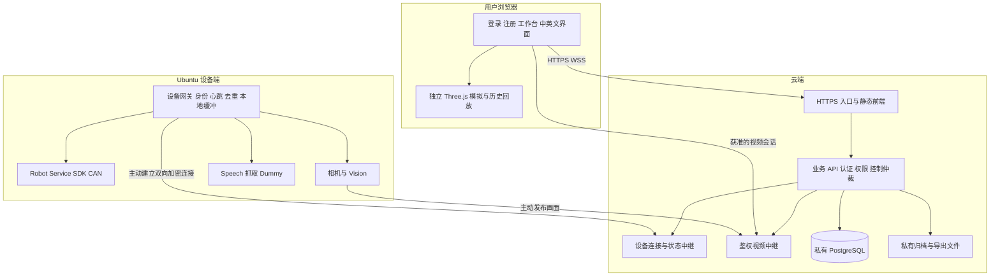
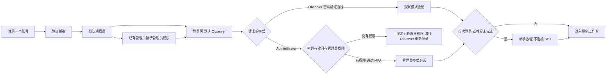
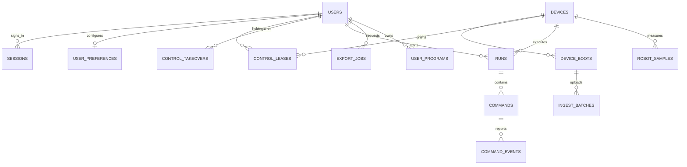

# ThirdHand 公网部署与账号权限数据库设计审批稿

版本：0.4.1；修订日期：2026-10-29；设计认可日期：2026-10-30。状态：用户已认可设计，进入执行计划审阅；产品尚未实施。

审批记录：用户于 2026-10-30 表示“设计方案没啥问题，给出执行步骤”。本记录认可本方案的业务架构与默认选择，不代表已经实施、批准某次未展示的服务器配置，或批准实际机械臂运动。执行顺序见 [实施总计划](../plans/2026-10-30-public-access-rollout.md)。

本方案支持管理员从外网连接 SDK、控制真机；观察员查看相机、操作 Three.js 模型，并查询完整机械臂运行记录。一个账号一次注册，独立登录页通过 Observer / Administrator 标签申请模式，每次默认 Observer。采用云端前端、业务后端、私有 PostgreSQL 与 Ubuntu 设备网关；数据库和 SDK 服务不直接对公网开放。网站使用 `uiea-thirdhand.com`，全站首次访问默认英文与浅色主题。

本文是架构与数据设计，尚未实施。除“已确认需求”和“现状”外，数值、保留期限和交互细节均为审批建议。本次只更新设计文档和保存用户提供的参考图片，不修改网页或控制代码，不创建数据库，不部署服务；Git 按用户同意建立独立 `login` 分支，不提交或推送。

## 1. 已确认需求与范围

### 1.1 已确认需求

1. 只有管理员、观察员两类业务角色，两类用户都必须先注册再登录。
2. 管理员可以从公网使用全部业务功能，包括连接、断开 SDK 和执行真机动作。
3. 观察员可以观看相机、查看全部机械臂运行记录；可以拖动滑条、选择固定点位、播放一套动作来操作 Three.js 模型。
4. 观察员不能连接 SDK、发送任何真机动作或使用语音控制。
5. 注册信息保存在数据库，管理员能够通过网站后台查看和管理。
6. 机械臂运行数据写入数据库，支持历史查询和复盘。
7. 保留中英文切换，登录、注册、教程、展示站、控制与历史界面首次默认英文；用户主动选择后记忆。
8. 登录是单独界面，默认浅色背景、可调整并记忆，与其他网页同步；可使用液态玻璃视觉，按本次四张截图和两个 CodePen 参考更新设计，旧深色稿不再是默认方向。
9. 登录页可切换 Observer / Administrator，默认 Observer；无管理员权限却申请管理员模式时明确提示，不能因此提升权限。
10. 观察员支持多账号、多设备同时在线；管理员登录并发与真机控制独占需区分，本稿在第 6.4 节给出建议及备选。
11. 公网域名为 `uiea-thirdhand.com`；展示首页第一屏与顶部导航各有进入控制工作台的按钮。
12. 新用户首次成功登录默认进入新手教程；教程由队友开发，本任务只预留入口及接口适配，具体对接在合并时完成，不重复实现教程；教程不产生 SDK 连接或真机动作。
13. 采用云端前端、业务后端、私有数据库与 Ubuntu 主动连接云端的结构；数据库确定使用 PostgreSQL。
14. 获取最新远端 main，在其基线上新建 login 分支修改；本次仅更新文档。

### 1.2 本期设计边界

按一个项目、多个用户、可扩展多台机械臂设计；当前可先接入一台。观察员可读本项目所有设备的完整运行记录，不限于本人产生的数据。后续若需要多个学校或团队之间隔离数据，再增加项目成员授权，本期不默认为观察员缩小数据范围。

管理员“全功能”包含全部业务入口，设备限位、速度限制、CAN 状态检查、软件停止和硬件急停仍然生效。公开注册不能直接获得管理员权限。公网提供监督式远程控制，云端不承担伺服闭环、毫秒级轨迹插补或硬件安全急停。

## 2. 现状与方案选择

### 2.1 当前仓库基线

本次执行 `git fetch --prune origin main` 后，远端 main 仍为 `56114e8`。用户同意使用独立目录后，从 `origin/main` 建立 `login` 分支，目录为 `D:/claudeworkplace/thirdhand-login`；原 main 中其他任务的未提交改动保持原状。分支创建与文档位置不代表远端已出现 login 分支。

| 现有模块 | 当前职责 | 本方案处理 |
|---|---|---|
| `apps/web/public` | HTML、CSS、Three.js、相机与语音界面；已有 i18n 代码 | 复用现有界面，拆出模拟、只读和真机命令通道 |
| `apps/web/src` | 9983 网关，代理 Robot、Vision、Speech、抓取等服务 | 分出云端业务 API 与设备端受控适配器；不把旧代理整体公开 |
| `services/robot` | 3000 Robot Service，驱动 Python 桥和 SDK | 保持在 Ubuntu，仅接受本机设备网关的受控调用 |
| `services/vision` | 3100，相机与视觉 | 本机采集，向云端发布获准的画面与状态 |
| `services/speech` | 3004，语音识别和动作候选 | 只向管理员模式提供受保护入口 |
| `skills/manipulation/bottlegrasp` | 8766，抓取相关服务 | 保留本机部署，通过同一控制仲裁入口执行 |
| `runtime` | 本地运行状态、日志和执行令牌 | 增加持久上报缓冲；密钥与设备私有令牌不发送浏览器 |

当前 WebSocket `/ws`、`/vision`、`/voice` 的升级入口没有统一账号会话与角色校验；局部同源检查和动作确认不能替代账号鉴权。Robot `/execution` 的本机执行令牌继续保留，它与公网用户登录凭据是两种不同凭据。

之前查到的 `feature/desktop-world-model` 分支有桌面与物品模型及其接口，尚未合入上述基线。部署前应单独审查选入的代码和资源；`runtime/world-model/assets/normalized` 中的模型需纳入部署资产包及哈希清单，不能假设拉取主分支后自动具备。

### 2.2 选择的方向与备选方案

用户选择的方向是“云端网站与数据库 + Ubuntu 本地设备服务”。在此方向下，本稿建议：前后端逻辑分离，首期对浏览器使用同一个 HTTPS 域名和 `/api` 路径，减少跨域登录与 Cookie 配置复杂度；前端和后端仍可独立构建、发布和扩容。

| 方式 | 适用性与代价 | 本稿建议 |
|---|---|---|
| 云端前端、业务后端、私有数据库；Ubuntu 主动连接云端 | 支持外网账号、统一记录与设备隔离；需增加设备网关和视频中继 | 采用 |
| 云端仅托管静态页面，所有用户先接 VPN 再访问实验室 | 接入面较小，但观察员也要安装与配置 VPN，不符合便捷注册访问的目标 | 作为运维访问方式保留，不作为主要用户入口 |
| 将当前 9983 或 SDK 端口直接转发到公网，再加一个登录页 | 旧代理接口和本地功能容易绕过页面权限，不满足两类角色隔离 | 不采用 |

前后端分离解决界面与业务接口的职责；云端与设备端分工解决执行位置。两者并非同一个维度：用户在云端登录，但真正初始化 SDK 的进程仍在 Ubuntu。

## 3. 部署与网络设计

### 3.1 总体结构

箭头中的设备连接由 Ubuntu 主动建立，建立后双向通信；云端可在已有连接中下发授权命令，实验室无需为 SDK 开放公网入站端口。

### 3.2 组件与端口

| 组件 | 部署位置 | 网络边界与访问者 |
|---|---|---|
| 前端与 HTTPS 反向代理 | 云端 | 对用户开放 443；80 可只用于跳转和证书验证 |
| Node.js 业务 API、设备中继 | 云端私有服务网络 | 由反向代理转发；不另开放裸业务端口 |
| PostgreSQL | 云端私有网络，首期独立服务或托管实例 | 5432 只允许业务服务和受控运维连接 |
| 对象存储 | 私有桶 | 业务 API 签发短期下载授权，不公开列目录 |
| 视频中继 | 云端 | 信令走 HTTPS；生产媒体所需 WebRTC/TURN 端口按中继方案配置 |
| Ubuntu 设备网关 | 实验室本机 | 主动连设备专用 HTTPS/WSS 入口，使用设备证书；不是用户 Cookie |
| Robot 3000、Speech 3004、Vision 3100、抓取 8766 | Ubuntu 回环地址 | 仅设备网关及现有获准的本机服务访问 |
| 旧 9983 页面与设备诊断 | Ubuntu 本机 | 仅本机或管理 VPN 可达，实施权限后仍不能绕开控制仲裁 |
| 数据库与服务器运维 | 管理网络 | 通过 VPN/堡垒机及密钥登录；不公开数据库管理面板 |

视频媒体可能需要独立 UDP 范围或 TURN/TLS 入口，不能承诺整个系统只使用 443。可用受限网络环境必须在上线前验证；TURN/TLS 与网页共用端口时需使用合适的独立 IP 或明确的代理方案。

### 3.3 初期部署形态

业务后端延续现有 Node.js 技术栈，前端延续 Three.js 与现有页面，不为“前后端分离”强制重写为其他框架。数据库已确定为 PostgreSQL；建议从 PostgreSQL 18 的受支持补丁版本起步，精确版本在实施时核验并锁定。首期用容器编排或 systemd 部署单实例后端；扩容前增加共享会话、控制协调和连接路由，不能只简单复制进程。

建议先准备独立测试环境，数据库、设备凭据和对象存储均与生产分离。域名为 `uiea-thirdhand.com`，用户提供现有云服务器的宝塔面板作为运维入口；当前资源、业务域名 SSL 与设备子域还不满足完整网关验收。后续是否扩容或分离数据库/媒体服务、部署地域及预算待确定。选定地域后核实对应的域名、备案、数据与隐私要求。

### 3.4 域名、展示站与独立登录页

以下是待实施的路径设计，不表示当前公网已具备这些路由。本次已在用户指定宝塔中看到展示站及其静态目录，HTTP 首页可访问；尚未检查展示站具体源文件和版本管理归属，不能假设它已经属于当前控制仓库。

| 地址 | 用途与进入规则 |
|---|---|
| `https://uiea-thirdhand.com/` | 公开展示站；第一屏主按钮及顶部导航都提供 Open Control / 进入控制工作台 |
| `/login` | 独立登录页面，不在 3D 控制页上覆盖登录弹窗；带 Observer / Administrator 标签 |
| `/register`、`/forgot-password` | 独立注册和找回密码流程，复用登录视觉、主题和语言 |
| `/tutorial` | 新用户登录后默认进入的教程；登录后可在帮助中重进 |
| `/control` | 经过鉴权的控制工作台；具体能力由服务端会话模式决定 |
| `/history` | 两类角色均可查询完整机械臂历史 |
| `/admin` | 仅管理员模式的账号、角色、设备和安全管理 |
| `/api/v1`、`/stream/v1` | 同域业务 API 与用户实时通道；不把裸设备端口写到网页 |
| `edge.uiea-thirdhand.com`，建议新增 | 设备专用 mTLS 入口；单独 DNS/证书，不要求普通浏览器持有设备证书 |
| `media.uiea-thirdhand.com`，按视频方案确定 | 媒体信令或 TURN/SFU 入口；令牌独立限定到设备及观看会话 |

两处 Open Control 按钮使用同一进入判定：未登录跳 `/login?return_to=/control`；已登录且教程未完成、也未选择稍后继续时跳 `/tutorial`；已有有效会话且完成或主动暂缓基础教程则进入 `/control`。暂缓只开放观察、模拟和已有账号管理权限，不绕过首次真机前的安全说明确认。`return_to` 仅接受站内允许路径，避免开放重定向。点击按钮、完成教程或进入工作台都不自动连接 SDK，也不自动申请控制权。

### 3.5 Ubuntu 设备网关的条件与门槛

设备网关是需要开发并安装在 Ubuntu 的后台服务，不是单靠域名解析或端口映射就能获得的能力，也不要求购买特定品牌网关硬件。现有 Ubuntu 若能稳定运行机械臂、相机和项目依赖，通常可承载此服务，最终以环境检查与压测为准。

| 条件 | 具体要求 |
|---|---|
| 硬件与 SDK | 与现有 Startouch/PCAN/CAN、相机驱动兼容；可读取实际状态、执行有边界的命令并验证停止效果。SDK 安装、驱动与硬件绑定仍是前置条件 |
| 运行环境 | 项目兼容的 Node.js、Python、系统库；后台服务可访问必要 CAN/USB 设备，以最小权限运行，不能将整个服务长期当 root 使用 |
| 外网连通 | 能解析云端域名并主动建立 HTTPS/WSS/TLS 连接，通常无需实验室固定公网 IP、路由器入站端口或给数据库放行。校园网代理、证书检查和长连接超时需实测 |
| 设备身份 | 运维在现场注册设备并安装独立证书和私钥，云端验证；能够更新、吊销和保护密钥，不共用用户账号密码 |
| 本地后台运行 | systemd 启动和监控，支持断线退避重连；开机可以上线和报状态，但不自动 connect SDK 或恢复运动 |
| 时间与数据 | 保持可信时间同步；本地持久缓冲按不少于 72 小时实测数据量预留，具备空间告警、序号、去重和补传 |
| 视频链路 | 满足实际分辨率、码率与延迟要求；优先单路上行、云端分发。WebRTC 所需 UDP 或 TURN/TLS 路径需要通过网络测试，不因 WSS 可连就认为视频可用 |
| 控制准入 | 本机所有控制入口纳入同一仲裁；看门狗、SDK 停止、会话撤销和断网策略通过现场验证，才开启公网真机能力 |

例如实测视频为 2 Mbps 时，可先按约 50% 上行余量做网络压测；这只是测试起点，不代表当前 MJPEG 的真实带宽。云端向 10 人分发不应让 Ubuntu 采集 10 份视频。公网 IP、GPU、额外 PCAN 等不是单纯“部署网关”的固定购买条件；GPU 是否需要取决于现有视觉/语音模型，不取决于账号登录。

网关不保存云端用户密码和数据库口令。管理员从外网操作的是经鉴权的业务功能，设备网关只接收限定设备、操作码、期限和控制权的命令，不能成为远程 shell 或任意 SDK 调用通道。

### 3.6 宝塔实查与校园网验证状态

用户提供的 `https://47.94.95.244:35399/` 是云服务器运维面板，不是观察员/管理员的业务后台，也不是机械臂设备网关。网页登录、权限和运行记录后台仍需开发，不能直接让业务用户使用宝塔账号。

2026-10-29 的只读观察：宝塔显示 Ubuntu 22、2 核 CPU、约 1.6 GB 内存、39 GB 磁盘，Nginx 1.28.3；已有 `uiea-thirdhand.com` 站点，目录 `/www/wwwroot/uiea-thirdhand-static`，列表中 SSL 显示“未部署”。公开 DNS 查询显示主域 A 记录为 `47.94.95.244`，`edge.uiea-thirdhand.com` 返回 NXDOMAIN；本机 HTTP 首页返回 200、HTTPS 握手失败。现有配置可先进行不接硬件的联通测试，数据库、视频中继和长期历史的生产容量需另行核算。

用户随后确认机械臂 Ubuntu 的 Tailscale 地址为 `100.85.63.78`。控制台显示设备 `ubuntu` 在线，SSH 使用原有主机密钥验证通过，主机内核为 `6.14.6-custom`。后续运维优先使用此地址，不依赖校园 LAN 地址 `192.168.58.68`；Tailscale 访问仍受设备共享、访问策略和 SSH 账号权限约束，本次没有修改这些设置。

已从该 Ubuntu 执行首轮只读网络探测：主域解析到 `47.94.95.244`，设备子域未解析，80/TCP 和 HTTP 首页正常（200），443/TCP 连接被拒绝，HTTPS 因此未成功。较早 Windows 探测的 443 可建立 TCP 但 HTTPS 握手失败，两侧现象不能简单合并为同一故障原因；需核对当前云端 443 监听、安全组/防火墙与站点 SSL，必要时再对比校园出口策略。WSS、mTLS、视频和长期稳定性仍未验收；一次 SSH 超时后重试成功也不证明链路持续稳定。

初始 Windows DNS 出现代理测试地址，已用公开 DNS 查询与 Ubuntu 实际解析交叉核对，测试时须注意系统代理与真实 DNS 的差异。Tailscale 在线能帮助运维，但不等于已完成公网业务网关部署。

学校网络下使用“Ubuntu 主动连云端”的方式通常不需要固定公网 IP 或路由器端口映射；需验证无交互网络认证、允许的出站 TLS/WSS、证书验证、长连接稳定性和视频上行。禁止用关闭证书验证或绕过学校网络管理要求解决连接问题。

具体配置步骤、宝塔与 Ubuntu 的职责、示意配置、无硬件探针及故障判定见：[校园网与宝塔设备网关部署说明](2026-10-29-campus-network-gateway-deployment-guide.md)。该说明中的配置和接口均未应用，网关程序和对接功能按执行计划及相应部署验收点实施。

## 4. 一个账号与工作模式

### 4.1 推荐流程

同一个人只注册一次。账号的数据库角色为 `observer` 或 `admin`；管理员继承观察员能力。独立登录页先选择 Observer / Administrator，再提交同一套账号密码；登录选择申请的是会话模式 `observe` 或 `admin`，不能改变账号角色。每次打开新的登录流程都默认 Observer，不记忆管理员模式；主题与语言可以记忆。

登录页两种模式均可点击，参考第二张图的双标签布局，不沿用其中的 SSO / Manual 文案。先完成账号密码验证；身份有效但没有管理员权限时提示 “This account does not have administrator access. Please sign in as an Observer.”，并提供切回 Observer 的入口，不建立管理员会话，也不静默授予或静默降级。账号或密码错误时仍显示统一认证错误，不能在验证密码前透露某账号是否是管理员。

已有会话可在工作台主动申请切换模式，仍需服务端检查；进入管理员模式需二次验证。管理模式登录成功只是获得业务权限，不代表已经获得真机控制权。

有效权限为“当前账号角色允许的权限”与“当前会话模式允许的权限”的交集。管理员在观察模式下也不能发送真机、语音或用户管理命令。

不建议同一人分别注册管理员、观察员两个账号：会分散历史记录和身份审计，增加密码维护成本。未来确有独立高权限账号隔离要求时可额外支持，但不是本期默认流程。

### 4.2 注册、授予和停用

- 注册字段：账号、昵称、邮箱、密码、确认密码；密码确认不入库。不默认采集身份证、家庭住址等无关信息。
- 邮箱验证通过后启用观察员权限；登录页提供重发验证、忘记密码和统一错误提示。
- 公开注册页面没有可生效的角色选项。若增加“申请管理员”，它只产生申请记录，不直接改变权限。
- 首位管理员也先正常注册、验证邮箱，再由服务器运维命令提升该账号；首位管理员建立后关闭引导入口，不存在“第一个注册者自动是管理员”。
- 后续由已有管理员在管理员模式中授予或撤销管理员权限，并再次验证身份、记录操作；阻止停用或降级最后一个有效管理员。
- 提升角色不会把已有观察会话自动升级；用户需重新选择管理员模式。降级或停用立即撤销管理权限、关闭对应控制连接并通知设备端。
- 管理员管理账号可查看账号、邮箱、昵称、角色、注册时间和账号状态；无法查看密码、恢复码或设备私钥。

### 4.3 会话与中英文

采用服务端会话，浏览器只持有随机会话 Cookie，设置 `Secure`、`HttpOnly`、`SameSite=Lax`，不放入 localStorage；变更类接口另做 CSRF 校验。数据库仅保存会话令牌的哈希。登录、模式提升时轮换会话令牌。

管理员模式强制多因素认证，首期建议 TOTP 与一次性恢复码；恢复流程不得通过单纯邮箱重置绕过管理员二次验证。观察员模式建议闲置 60 分钟、最长 24 小时；管理员模式建议闲置 15 分钟、最长 8 小时。管理员 MFA 验证的有效期与敏感操作再验证窗口需单独限制，控制心跳和后台相机刷新不算用户活动。

模式存储在服务端会话，同一浏览器的标签页共享模式并同步通知。切回观察模式前先撤销该会话控制权并完成停止确认；失去设备连接时显示状态未知且禁用重新授权，不能假装动作已停止。退出登录后立即撤销会话及其 WebSocket，设备端按失去授权策略停止。

`users.locale` 保存 `en` 或 `zh-CN`，新账号默认 `en`；没有主动语言选择的访问者全站默认英文，不因操作系统是中文而默认切换。未登录时可记忆语言，已有明确选择继续生效。语言覆盖展示站、登录、注册、模式标签、教程、操作提示、用户管理、历史查询和错误提示。数据库保留稳定事件代码与单位，前端按语言翻译，不把可变中文文本当业务状态。

### 4.4 登录视觉、主题与偏好同步

登录页采用独立居中卡片，默认浅色纯色或柔和渐变背景；顶部保留 ThirdHand 标识、语言与主题入口。表单包含角色标签、账号、密码与显示密码按钮、登录按钮、注册和找回密码入口。两种模式共用账号体系，不创建两套注册表。

可以采用液态玻璃的半透明、背景模糊、细边缘高光和轻微折射层次；表单文字、焦点、错误提示和标签选中状态必须清楚。模糊不支持、性能不足、减少动态效果或高对比度环境下，降级为清晰实色卡片。装饰动画不挡输入和键盘操作，不默认使用视频背景。

用户四张参考的用途：

| 参考 | 采用的方向 | 本项目不因此增加的功能 |
|---|---|---|
| 图 1：浅背景与居中登录卡片 | 安静浅色背景、清晰表单层级 | 不使用 Microsoft 标识，不加入 Outlook 接入 |
| 图 2：双标签登录卡片 | Observer / Administrator 的切换与默认选中状态 | 不把 SSO / Manual 当作角色，不默认增加学校 SSO |
| 图 3 与第一个 CodePen | 玻璃卡片、柔和色块、透光边缘 | 深色仅作可选主题；不加入 Google/Facebook 社交登录 |
| 图 4 与第二个 CodePen | 透明层次、输入框、圆角主按钮 | 不默认使用沙漠图片或未经授权的外链资源；不复制其演示账号认证逻辑 |

两个 CodePen 是视觉参考，不是可用于生产的认证实现；尤其第二个页面的浏览器示例账号与密码逻辑不得进入本项目。未来实现以服务端认证为准；图片、字体和第三方代码需核实使用许可和依赖来源。

偏好同步规则：

1. 首次无偏好：`locale=en`、`theme=light`。可提供浅色、深色和现有其他配色，背景/强调色使用允许的主题参数；不开放任意脚本或远程样式 URL。
2. 展示、登录、注册、教程、控制、历史与后台共用同一偏好读取模块和版本。相同 `https://uiea-thirdhand.com` 源可用本地存储及跨标签通知同步，不假设不同子域能直接共享 localStorage。
3. 未登录时的手动选择立即更新本机缓存；登录后，本轮明确手动选择优先并写回账号。没有本轮手动选择时，优先账号已保存偏好，再使用本机缓存，最后用默认值。
4. 登录后的修改写入账号数据库并更新本机缓存；后续在其他设备登录时读取该账号偏好。不同账号偏好分开保存，不把公共电脑上上一人的自动缓存写入下一人的账号。
5. 无痕模式或本地存储不可用时使用会话内选择，登录后仍可从账号读取；不得因无法记忆主题阻止登录。退出后可保留本机非敏感主题与语言，不能保留已授权管理员模式或认证令牌。

参考图片原件保存在本稿旁的 `assets/login-references-2026-10-29/`，仅作设计审阅，不是上线页面的品牌或背景素材。后续视觉效果图需按本节更新并重新审批，本次不生成页面代码。

### 4.5 新用户教程与完成状态

新手教程由队友负责。本模块只负责登录后的进入判定、调用教程入口与状态适配、返回控制页；不重复制作教程页面、步骤、动画、判定和进度数据库。具体接口路径、模块导出、返回字段与合并方式由双方在合并时确定，本稿中的 `/tutorial` 是建议的用户路径，不是要求队友重写现有路由。

待合并时约定的接口边界：稳定用户 ID 与当前模式如何传递；教程入口；读取当前用户进度/版本的方式；完成、暂缓和返回的可信状态；语言/主题注入或读取；错误、权限和退出处理。优先复用同域登录会话，不在 URL 中传密码或访问令牌。教程数据只保留一个权威来源，不能让登录模块和队友模块各自维护一套相互冲突的完成状态。

首次成功登录仍默认进入教程；跨设备恢复、可否暂缓、重看及版本升级策略按双方最后确认的接口实现。若采用暂缓，须明确持久状态，避免 `/control` 与教程之间循环跳转。默认英文、全站主题同步、所有练习仅模拟且不连接 SDK 是集成要求。队友接口尚未接好或暂时不可用时显示教程未接入/暂不可用，可保留观察功能；不伪造已完成状态或自动开启真机权限。

首次真机操作前的管理员安全说明确认由控制后端单独校验，不把教程页面发来的 `completed=true` 当作真机授权。是否复用队友提供的可信服务端确认接口在合并时定；账号角色、MFA、控制权和设备验收无论教程状态如何都不可绕过。

## 5. 权限与 Three.js 隔离

### 5.1 权限矩阵

| 功能 | 未登录 | 观察员模式，包括管理员主动进入此模式 | 管理员模式 |
|---|---|---|---|
| 注册、登录、密码重置、语言选择 | 允许 | 允许适用入口 | 允许适用入口 |
| 查看实时相机，创建视频观看会话 | 禁止 | 允许 | 允许 |
| 查看真机关节、TCP、SDK 状态的只读副本 | 禁止 | 允许 | 允许 |
| Three.js 滑条、固定点位、动作序列、模拟回放 | 禁止 | 允许，仅浏览器模拟 | 允许，必须区分模拟与真机 |
| 查询、回放、导出全部机械臂运行记录 | 禁止 | 允许，包括其他用户触发的真机动作 | 允许 |
| 申请控制权、连接和断开 SDK、真机运动、夹爪、Home、软件停止 | 禁止 | 禁止 | 允许，受设备仲裁和现有安全检查约束 |
| 语音或文本产生的控制指令、真实抓取、Dummy 跟随 | 禁止 | 禁止 | 允许，统一进入真机命令检查 |
| 管理用户、授予角色、设备接入配置 | 禁止 | 禁止 | 允许，敏感操作再次验证 |
| 查看账号安全日志、注册用户列表 | 禁止 | 禁止 | 允许 |
| 查看原始密码、会话令牌、设备私钥 | 禁止 | 禁止 | 不提供查看功能 |

“完整机械臂运行记录”包括全部已保存的采样、动作参数、执行结果、设备故障和执行者展示名称，不限本人、不因观察员角色降采样。注册邮箱、密码、登录令牌、IP 安全日志不是机械臂运行记录；它们分别受用户管理和安全日志权限管理。

### 5.2 模型操作

浏览器提供三个明确视图：独立模拟、实机姿态只读镜像、历史回放。观察员拖动滑条或执行固定点动作时自动进入独立模拟，不改变真机，也不改变其他观察员的模拟。实时镜像更新不能覆盖正在编辑的模拟；“同步实机姿态”只复制一次已获准读取的状态。

模拟动作在浏览器内进行插值、播放和暂停，无 SDK 依赖。观察员访问网站、相机和历史记录均不能隐式创建 SDK 连接；SDK 离线时显示“SDK 未连接”及最后状态的采集时间。

真机动作入口独立命名，例如“发送到真机”，不得复用一个“执行”按钮暗中切换路由。管理员模式中模拟仍只模拟，需明确选择真机设备并取得控制权后才允许执行真机动作。模拟数据标记 `environment=simulation`，真机记录标记 `environment=real`，历史回放永远不能触发重执行。

### 5.3 服务端强制执行

每个 HTTP 请求、WebSocket 握手和命令消息都检查会话、账号当前角色、模式与设备权限。观察员只接入独立的 telemetry/video 通道，不能接入旧的裸 `/ws`、`/execution`、`/voice` 或控制代理。

客户端提供的 `role`、`mode`、`userId`、`authorized:true` 和命令类别不作为权限证据。云端剥离伪造的内部头，设备端再次验证命令签名、设备身份、控制权和期限。WebSocket 采用明确 Origin 白名单、消息大小和速率上限，退出、降级或过期时使已连接会话失效。[依据：OWASP Authorization 与 WebSocket Security，见第 15 节。]

## 6. 外网真机控制链

### 6.1 身份与单设备控制权

Ubuntu 设备网关使用单独签发的设备证书主动建立 mTLS 加密连接，设备私钥只保存在设备端；浏览器登录 Cookie 不能冒充设备。设备首次绑定需运维确认，证书支持轮换、过期和吊销。心跳或自动重连不自动连接 SDK、恢复控制权或恢复运动。

设备证书证明网关身份，不能单独证明接着的是哪台机械臂。首次接入要保存 commissioning 绑定记录，关联 `device_id`、网关证书、机械臂硬件唯一身份（SDK 能可靠提供时）、CAN 适配器身份、接线/配置摘要与现场确认者。CAN 电机地址或网卡地址不作为机械臂唯一身份的替代证明；连接 SDK 时核对可用身份和配置。

另设 `executor_epoch`，代表当前 Robot Service / SDK 执行实例。Robot Service、Python SDK worker 重启、SDK 对象重新创建、CAN 映射或硬件绑定改变时，设备立即使原控制权失效，生成新执行代次并重新验证，命令同时绑定 `boot_id + executor_epoch + lease_epoch`。Agent 未重启也不能沿用旧执行实例授权。若该机型没有可靠硬件身份接口，首次接入及执行实例/接线变化后须现场人工确认绑定，确认前只开放相机、历史、模型和诊断，不开放运动；这一人工准入代价在设备验收前确认，不伪称软件能自动识别换臂。

同一台机械臂同时只有一个有效真机控制持有者，绑定 `user_id + session_id + client_instance_id + device_id`。同一管理员的两个标签页也需分别申请，不能靠同一个账号并发控制。手动动作、语音、固定点位、抓取和 Dummy 都纳入同一仲裁，避免不同入口各自认为自己空闲。

控制权由云端事务分配并在设备端确认后生效。每次授权带递增 `lease_epoch`，设备端记录最高代次并拒绝旧代次；控制权释放、掉线、角色撤销或设备重启后，旧命令不能重新生效。若设备未确认释放，不向另一个操作者授权；先与设备核对或由现场复位。

其他管理员可请求撤销持有者或发送软件停止；停止不受普通“正在忙”队列阻塞。观察员不能停止真机。管理员接管需完成停止、确认新鲜状态后重新授权，不允许直接抢占运动中的连接。现有本机页面、CLI、Dummy 入口必须接入此仲裁或在远控运行时禁用；仅保护云端而保留本地旁路不满足验收。

### 6.2 命令流程

1. 管理员完成登录、管理员模式与 MFA，选择设备并申请控制权。
2. 云端检查权限、账号版本、当前设备在线状态、控制权和命令白名单，将请求及操作者写入运行审计。
3. 云端签发短期命令封装，包含 `command_id`、设备与启动会话、控制权代次、序号、操作码、参数、签发时间和有效期限；不支持任意 shell、Python 或透传未知 SDK 方法。
4. 设备网关验证签名、时间偏差、当前控制权、序号、去重记录、设备状态和配置版本，再转为现有本地命令。
5. Robot Service 保留当前六关节状态、500 ms 状态新鲜度、速度和限位等检查；连续控制闭环、轨迹执行留在 Ubuntu。
6. 返回 `accepted_by_cloud`、`accepted_by_edge`、`started`、`completed`、`rejected`、`failed`、`stopped` 或 `unknown` 等可区分结果；网页收到确认不能直接写成“动作完成”。
7. 设备采样和结果关联同一 `command_id`、`run_id`，经本地持久缓冲上报数据库，供两类用户读取。

所有运动命令禁止断线排队后自动补发。至少一次传输只用于状态和日志；控制依靠幂等和过期拒绝来避免重复提交。SDK 已接收但确认丢失时标记 `unknown`，查询状态或现场核对，不承诺分布式“恰好执行一次”，也不自动重试动作。

### 6.3 失联与停止默认值

以下是待现场测试的起始参数，不是已经验证的安全指标：控制续期每 250 ms，设备本地控制权有效期 1 s；普通新运动请求的投递有效期 1 s，不能用作动作总时长；界面状态超过 1 s 标为陈旧。原有 Robot 的 500 ms 状态检查不得因公网延迟而放宽。云与设备时间差超限时拒绝新运动，设备控制权超时使用单调时钟。

续期必须覆盖“持有者标签页 → 云端会话 → 设备”的整条链：持有者标签页每 250 ms 通过专用控制连接响应新鲜挑战，云端仅在最近 500 ms 内收到该连接有效响应、账号/模式/MFA/控制权仍有效且设备执行代次一致时才发送续期。云端不能因为自己到设备的连接还通着就代替浏览器无限续期。挑战绑定当前连接实例与递增序号，旧响应、重复响应、旧连接及自动重连不能复活控制权；重连必须重新申请。设备最终按本地单调时钟超时撤权，断网时撤权上限受已批准的本地控制权期限约束，不能声称网络异常下“瞬间撤销”。

- 用户退出、切模式、关闭控制标签页、撤销权限或续期中断：停止接收新动作，设备本地看门狗请求停止当前动作；不自动 Home、移动到零位或断电。
- 公网断开：设备端本地超时生效，无需云端再发一条停止消息；恢复连接后先核对状态并重新申请控制权。
- 云端数据库不可写：拒绝新控制请求，避免执行没有操作者记录的命令；设备端现有任务按授权失效策略停止，停止本身不得依赖数据库。
- 停止失败或 SDK 没有停止确认：显示“停止未确认”，禁止再次运动，不伪报已停；由现场硬件急停或人工处理。
- 首期远控需要现场有可达的硬件急停与授权值守；不把本方案当作无人值守或经过安全认证的远程急停系统。若要无人值守，需要单独设计并验证安全围护与硬件联锁。

已有 SDK 的可中断性、各类动作的停止耗时、看门狗独立性和相机端到端延迟必须先测量；达不到现场批准的停止指标时，真机公网功能保持关闭。管理员全功能是通过这些准入验证后的能力。

### 6.4 多端登录与单人控制的建议

建议限制“单设备同时一个真机控制者”，不限制“整个网站同时只登录一个管理员”。管理员可以同时查看日志、管理账号或看相机，第二个管理员单纯登录不应打断第一个人的动作。观察员允许同一账号多端和多个不同账号同时在线；每个会话独立到期、退出和撤销，退出一台不会默认退出其他端，另提供主动退出全部设备。

| 策略 | 行为与问题 | 本稿选择 |
|---|---|---|
| 网站只允许一个管理员会话 | 第二人登录便要踢掉前人；看记录也会干扰控制，多设备、多标签及本机登录都容易发生无意中断 | 不作为默认；仅在用户明确坚持时另行审批 |
| 多管理员可登录，每台机械臂只有一个控制持有者 | 登录与查看不冲突；只有真正请求同一设备的控制权时才处理接管 | 已随整体设计获认可，按此执行 |

本稿推荐的并发规则：管理员角色和管理员模式会话均可多端存在；真机控制权仍绑定某一账号、会话、标签页和设备。管理员 A 控制机械臂时，管理员 B 登录后可查看完整记录、相机和自己的模拟，界面显示 A 持有控制权，B 的真机命令禁止发送。

B 主动点击 Take Control / 申请接管时，显示现持有者与动作状态，提示：“继续接管将停止当前动作并撤销上一位使用者的真机控制权限；对方账号仍保持登录。是否继续？”英文默认提示提供相同含义。按钮是 Cancel / Continue Takeover，不能把普通 Log in 当作接管确认。

用户确认并通过需要的再次认证后，云端将设备标记为 revoking，通知原持有者并停止续期，由设备优先执行停止。只有取得当前执行实例的停止确认、旧控制权失效和新鲜状态后，才生成新控制代次并授予 B。停止未确认、设备离线或状态不明时，B 只能看到接管未完成，不得直接获得运动权限。A 降为“已失去控制权”的已登录状态，仍可看视频、日志与模拟；不会自动断开所有业务会话。

接管确认绑定目标 `lease_epoch` 与短期一次性确认凭据；确认前持有者已变更则要求重新确认，避免陈旧弹窗误踢第三人。接管申请、确认、停止结果与最终授予均记录操作者和时间。B 在等待期间退出或失去权限时不能授予控制权，也不自动恢复 A 的运动。

现场人员可以优先停止，但“来自 Ubuntu 本机 IP”不自动获得控制权。运动相关配置变更、SDK 重建和设备维护也必须经过设备空闲/维护状态检查，不能由另一个已登录管理员悄悄更改正在执行的控制参数。

### 6.5 实验室 Ubuntu 的登录与维护建议

应分清三个身份：Ubuntu 操作系统用户、后台设备服务身份、使用网页的人员账号。

- **设备后台服务**：使用专用系统服务身份、设备证书和最小 CAN/USB 权限，由 systemd 管理；开机可主动连云、采集状态和上传已获准画面，无需有人先登录网站或桌面。服务上线不自动初始化机械臂 SDK。
- **在本机打开网页的人**：建议和外网一样使用个人账号登录，选择观察或管理员模式；正常本机真机操作也参与同一设备控制仲裁，不设“坐在这台电脑前就永远是管理员”。不长期保存共享管理员密码、永久管理 Cookie 或按 127.0.0.1 免登录。
- **无人值守展示屏**：可只展示公开宣传内容；若要显示相机或完整记录，应登录专用的最小权限观察员账号并按会话政策管理，不能自动登录管理员。
- **物理急停**：始终独立于网页与网络，不要求网站登录。网页的软件停止仍依业务权限处理，不能被宣传为硬件急停。

现场维护时须明确进入设备维护状态，撤销远程控制权并确认停止后，才能由受控的本机运维工具操作；退出维护后重新核对设备与执行代次，不能自动恢复先前远控动作。维护状态是设备状态，不新增第三种网站业务角色。

本期不设计“断网即可匿名使用本机控制网页”。云端不可达时保留硬件急停和受 Ubuntu 账号、现场访问控制保护的维护手段；维护操作在本地记名持久记录并补传。若需要断网时仍通过网页登录并操作真机，应另行批准离线身份、有效期和吊销方案，不能简单缓存一份永不过期的管理员权限。

## 7. 相机与语音

两类已登录用户都可观看相机；观察员视频权限仅包含视频与必要时间戳，不含麦克风、语音 WebSocket 或控制消息。建议生产视频使用有鉴权的 WebRTC 中继，由 Ubuntu 单路发布后云端分发，避免每位观察员单独占用一条实验室上行。现有 MJPEG 可用于受控测试或兼容展示，不直接当作默认的低延迟真机远控画面。

视频会话由业务后端根据账号签发短期访问授权，限制设备、观看范围和期限；退出、停用后终止观看。现场断流时显示最后帧时间和离线状态。管理员真机工作台要求画面与设备状态均足够新鲜；画面不可用或超时则阻止新运动，并按批准的本地策略停止连续跟随。不能只根据浏览器的“画面正常”布尔值认定设备可控。

语音、文本控制产生的动作候选都与当前管理员会话和控制权绑定；MFA、角色与设备检查同样适用。模型只能建议允许的结构化动作，不能自行连接 SDK 或绕开控制权。观察员即使重放管理员语音请求也必须得到拒绝。

首期不默认录制相机与原始音频。若批准录制，视频文件进入私有对象存储，数据库保存索引、权限和保留策略；不是把视频帧直接写入关系表。实时视频、录制和历史动作数据是不同数据集。

## 8. 数据库总体设计

### 8.1 存储分工与完整性

云端 PostgreSQL 是用户、角色、会话、设备、动作及运行历史的业务主库。Ubuntu 本地 SQLite WAL/outbox 是可断网补传的持久缓冲，不是另一套注册账号库。备份、导出文件、模型包及以后批准的录像放入私有对象存储。

机械臂运行数据包括“请求的目标”“SDK 接收状态”“实际观测的关节和 TCP”“执行结果”，分别存储，不能用目标值充当实测值。保存设备实际发布的全部可采集状态；字段未由 SDK 提供时标为不可用，不能补零冒充已测量。界面曲线可以聚合显示，完整查询与导出保留原始采样。

本期原始采样保留在 PostgreSQL，按时间分区；不默认在 30 天或 90 天后删除、仅保留平均值或移走后无法查询。容量先按 90 天估算，超过预算前告警并扩容或提交明确的归档审批。完整运行记录的保留时长和删除规则作为审批项；未批准删除策略前不自动删除历史。

### 8.2 通用约定

- 实体主键使用 UUID；采样使用包含分区时间的复合主键。数据库时间使用 UTC `timestamptz`，页面按用户时区展示，中文默认 Asia/Shanghai。
- 身份资料、机器人运行数据、安全日志、模拟数据分 schema 管理；浏览器不能直连数据库。
- `created_at`、`updated_at` 由服务端生成；设备时间另存 `captured_at`，云端接收时间另存 `received_at`，保留 `boot_id`、单调时钟、序号与时间质量，方便判断乱序、断档和时钟漂移。
- 角度统一弧度、长度米、关节速度弧度每秒；页面可转换为度和毫米。TCP 保存基坐标系位置及 `xyzw` 四元数，并关联工具、坐标系、标定和 SDK 配置版本。
- 结构化字段使用明确类型与约束；JSONB 只用于版本化的扩展数据及命令参数，不用一张无结构日志表承载全部业务。
- 注册与命令使用参数化 SQL。用户停用采用软停用，历史外键不级联删除；运行审计采用追加写和勘误说明，后台不能悄悄改写已执行动作。

## 9. 数据表与关系

### 9.1 账号与会话

| 表 | 主要字段 | 约束与用途 |
|---|---|---|
| `auth.users` | `id`、规范化 `username`、`email`、`display_name`、`password_hash`、`role`、`status`、`locale`、`role_version`、`email_verified_at`、注册/更新时间 | 账号、邮箱大小写规范化后各自唯一；`role` 仅 observer/admin；`locale` 默认 en；`status` 为 pending_email/active/disabled，不是第三类角色 |
| `auth.sessions` | `id`、`user_id`、`token_hash`、`mode`、`role_version`、`mfa_verified_at`、客户端展示名、`last_user_activity_at`、闲置/绝对到期时间、撤销时间 | 一个用户允许多个独立会话，不设全站仅一管理员的唯一约束；令牌哈希唯一，角色版本及模式由服务端校验 |
| `auth.user_preferences` | `user_id`、`theme_id`、经 schema 校验的 `background_config`、`revision`、更新时间 | 每用户一条，默认 light；locale 以 users.locale 为准；前端主题修改与账号同步，不能放任意脚本/CSS |
| 教程进度接口，表名与所有权合并时确定 | 用户 ID、教程版本、进度、完成/暂缓状态等由队友接口提供 | 不默认新增本模块的 auth.user_onboarding 表；合并时确定唯一权威来源及需要的适配/外键 |
| `auth.one_time_tokens` | `id`、`user_id`、`purpose`、`token_hash`、`expires_at`、`consumed_at` | 邮箱验证、重置密码；一次性、短期；不明文保存链接中的令牌 |
| `auth.mfa_credentials` | `id`、`user_id`、`kind`、加密 TOTP 密钥、启用/撤销时间、恢复码哈希 | 加密密钥放在独立密钥管理中；恢复码只能使用一次 |
| `auth.role_changes` | `id`、`target_user_id`、前后角色、`actor_user_id`、理由、时间 | 完整记录管理员授予/撤销，保护最后一个有效管理员 |

密码使用 Argon2id 的成熟实现，保存带算法、盐和成本参数的哈希，不保存可解密密码。账号后台只能重置流程或停用，不能查看原密码。会话令牌、验证令牌用高熵随机数，只存摘要。密码/MFA、数据库口令与设备密钥不能进入运行记录或导出文件。[依据：OWASP Password Storage，见第 15 节。]

### 9.2 设备、控制权与动作

| 表 | 主要字段 | 约束与用途 |
|---|---|---|
| `ops.devices` | `id`、设备名、硬件序列号、启用状态、`last_seen_at`、`control_epoch`、能力与配置版本 | 序列号唯一；存注册信息，不把最后一次在线状态当作当前可控证明 |
| `ops.device_credentials` | `id`、`device_id`、证书序列号、指纹、公钥信息、有效期、撤销时间 | 不存设备私钥；与用户账号分离 |
| `ops.device_boots` | `boot_id`、`device_id`、Agent/SDK 版本、开始/结束时间、配置与标定哈希 | 每次设备网关启动产生新 boot；启动后默认无控制权 |
| `ops.execution_instances` | `executor_epoch`、`device_id`、`boot_id`、Robot/SDK worker 实例标识、硬件身份与配置摘要、绑定确认记录、开始/结束时间 | 下层单独重启也创建新实例；命令和控制权必须绑定当前实例 |
| `ops.control_leases` | `id`、`device_id`、持有用户/会话/标签实例、`lease_epoch`、状态、申请/确认/到期/释放时间 | 每设备至多一个 requested/active/revoking 控制权；数据库事务与设备确认共同决定生效 |
| `ops.control_takeovers` | `id`、设备、申请用户/会话/标签、目标 lease/epoch、确认凭据摘要、状态、过期时间、停止与授予结果 | 接管绑定当时的持有者，凭据一次性；旧持有者变化、申请人退出或无权时不授予新控制权 |
| `ops.runs` | `id`、`device_id`、`boot_id`、发起者、来源 manual/preset/sequence/voice/grasp/dummy/local_maintenance、开始/结束、最终状态 | 将一套动作及其采样关联起来；保存执行者展示名快照、相关版本 |
| `ops.commands` | `command_id`、`run_id`、设备、会话、控制权与代次、序号、操作码、版本化参数、期限、当前状态、结果 | 只记录 real 命令；唯一命令 ID；同一设备/boot/控制代次/序号唯一；操作者来自服务端 |
| `ops.command_events` | `id`、`command_id`、`edge_event_id`、事件码、设备采集时间、云端接收时间、结构化详情 | 追加写；`edge_event_id` 去重；当前命令状态是这些事件的可重建投影 |
| `ops.device_events` | `id`、`device_id`、`boot_id`、`edge_event_id`、事件码、级别、时间、详情 | 连接/断开、故障、停止、上报缺口、SDK 状态变化；不混入登录令牌或服务器安全日志 |

设备重启、控制权变更和网络恢复后，不能仅凭数据库中 `active` 状态继续执行；需验证当前设备连接、boot、控制代次和本地未过期的授权。数据库中的设备停止状态也不能代替 SDK 的真实停止确认。

现场维护记录同时保存 `actor_kind=local_os`、本机 OS 账号标识和维护状态证据；关联到已登记人员时再填写真实 `actor_user_id`，不能伪造一个云端管理员 ID。正常网页控制的 `actor_kind=user` 必须有有效管理员用户、会话和控制权；运维身份不构成第三类网站角色。所有维护动作和缺口同样进入完整机械臂运行记录。

### 9.3 实际运行采样

`telemetry.robot_samples` 按 `captured_at` 的日或月范围分区，首期建议月分区，结合实际频率决定是否改为日分区。每条记录保存一次设备完整状态，而不是六关节分成六条行。

| 字段组 | 建议字段 |
|---|---|
| 身份与去重 | `device_id`、`boot_id`、`sample_seq`、`captured_at`、`received_at`、`monotonic_ns`、`clock_quality`、`schema_version` |
| 动作关联 | 可空 `run_id`、`command_id`；空闲采样不伪造动作 ID |
| 关节 | `joint_position_rad[6]`；SDK 支持时保存 `joint_velocity_rad_s[6]`、电流、扭矩、温度及字段可用性 |
| TCP 与夹爪 | `tcp_position_m[3]`、`tcp_orientation_xyzw[4]`、`tcp_frame_id`、工具/标定版本、夹爪状态 |
| 连接与有效性 | `sdk_connected`、`moving`、故障码、状态年龄、质量标记、源采样时间是否可靠 |
| 扩展 | 经白名单校验的 `extra` JSONB，不接收任意日志或凭据 |

约束：数组长度与数字有限性在入库前校验；数据库对数组维度和业务枚举追加约束，非法样本进入隔离记录并产生缺口事件。主键包含 `(device_id, captured_at, boot_id, sample_seq)`，满足分区约束。

仅靠这个主键不足以去除“同一序号、不同时间戳”的重复：另设非时间分区的 `telemetry.ingest_batches`，以 `(device_id, boot_id, stream_kind, batch_seq)` 唯一，保存样本序号范围、批次摘要、行数和完成时间。相同批次与摘要再次上传只返回已确认；相同批次但内容不同拒绝并告警。

跨批次也必须去重：每个流的持久样本序号只递增，源批次在 outbox 中定稿后不能重新切分、改号或改写时间戳；一个批次的首尾序号必须覆盖其全部连续样本，每个序号恰有一个有效样本或明确的无效样本记录。批次账本使用 PostgreSQL range 与排除约束，禁止同设备/boot/流的序号范围相互重叠；可用 `btree_gist` 将身份等值条件与序号范围相交约束组合。写账本、有效采样、无效记录在同一事务提交，靠数据库约束解决并发竞争，而不只在应用层先查再插。

同一 `sample_seq` 即使换了批次编号或采集时间也会因序号范围重叠被拒绝；部分重叠或同序号不同内容均告警、保留冲突证据并要求源端恢复原批次，不静默覆盖。`telemetry.invalid_samples` 保存设备、boot、批次、序号、拒绝原因、脱敏后源字段和接收时间，供完整运行记录查询显示缺口。批次账本保留到设备 boot 正式封存、拒绝其后续上传为止，不能先删除去重账本又允许旧批次重放。

另设 `ops.device_latest_state` 或进程内缓存作为“最后已收到状态”的读模型，带采集时间与 TTL。控制端仍使用设备本机的新鲜状态检查，不从数据库读取历史样本来推断当前安全性。

### 9.4 模拟、导出与安全日志

| 表 | 主要字段 | 权限与用途 |
|---|---|---|
| `simulation.user_programs` | `id`、所属用户、名称、模型版本、点位/动作序列 JSONB、更新时间 | 两类角色均可保存自己的模拟方案；不得把保存当作执行真机授权 |
| `ops.export_jobs` | `id`、申请者、设备与时间过滤、状态、私有对象键、行数、摘要、有效期 | 两类角色可导出完整运行记录；下载再次校验登录，不公开对象存储路径 |
| `ops.artifact_versions` | `id`、类型、版本、模型/配置/标定摘要、私有资源引用 | 历史回放需要知道当时模型与坐标约定；访问不泄露私钥配置 |
| `security.audit_events` | `id`、操作者、事件码、对象 ID、结果、时间、必要的安全上下文 | 登录失败、MFA、角色变更、密钥轮换等；仅管理员模式可查，令牌与密码一律脱敏 |
| `media.recordings`，以后启用录制时 | 设备、起止时间、文件索引、编码、大小、保留策略 | 本期不创建默认录像任务；若启用再明确观看权限和保留期 |

观察员查询所有真机运行记录与查询自己的模拟方案是两种不同范围；观察员不因看完整真机记录而获得其他人的账号资料或私人模拟草稿。模拟回放内容不写入真机采样表。

### 9.5 关系图

### 9.6 索引、读写账号与备份

- 用户：规范化账号、邮箱的唯一索引；会话令牌唯一索引；用户有效会话索引。
- 动作：`(device_id, started_at DESC)`、`(run_id, sequence)`、`(command_id, captured_at)`；控制权使用每设备至多一个有效记录的部分唯一约束。
- 遥测：分区剪枝；分区内按 `(device_id, captured_at)` 查询，按需增加时间 BRIN 索引。所有下载分页或异步导出，禁止一次将全表载入内存。
- 数据库服务账号分为迁移账号、账号业务账号、设备数据写入账号、运行数据查询账号；网站管理员身份不等于数据库超级用户。
- 密码、证书与 Cookie 签名材料使用环境密钥或密钥管理，不进入 Git。MFA 加密密钥与数据库备份分离管理。
- 建议每日基准备份并持续保存 WAL，目标 RPO 不超过 5 分钟、RTO 不超过 4 小时，作为待演练验收目标；备份加密、异机保存，至少每月做一次恢复演练。设备端已持久化但未上传的数据可通过 outbox 补传，不能声称覆盖设备磁盘与云端同时损坏。
- 备份用于故障恢复，不能替代用户可查询的历史数据保留。[依据：PostgreSQL 分区与 PITR 文档，见第 15 节。]

## 10. 数据上报、断网与查询

### 10.1 上报顺序

1. 设备网关按源发布频率采集实际状态，以 `boot_id + sample_seq` 编号，与动作事件一起先追加本地 outbox。
2. 数据按有界批次上传，包含序号范围和摘要；命令结果、故障和停止事件优先于普通遥测。
3. 云端校验设备身份、schema、大小、数字有效性和时间质量，在同一事务写入数据与批次账本。
4. 事务提交后才发送“已持久保存”确认；设备收到该确认后才可回收对应本地缓冲。网络层收包确认不等于数据库持久化。
5. 断网时继续缓存；恢复后对日志和遥测补传、去重、保留原始采集时间，界面标明迟到数据与断档。历史补传永远不能复活过去的动作命令。

outbox 大小按至少 72 小时的实测数据量预留，并设空间与最长未确认时间告警。容量不足时不能静默丢弃、阻塞 SDK 控制线程或影响停止通道；拒绝新真机任务，正在运行任务按本地已批准策略停止，记录缺口与原因。事件与停止记录使用预留空间。

### 10.2 历史页面与导出

两类用户都能按设备、时间、动作来源、运行结果、故障和执行者筛选；查看完整采样曲线、目标/实测对比、动作事件时间线，以及以历史姿态驱动 Three.js 回放。可导出 CSV/JSON 与关联版本信息。

完整数据量较大时采用游标分页和异步导出，不以“只显示前 1000 条”代替完整查询。页面聚合曲线需显示聚合级别，并保留“原始数据”入口。历史视图、当前实机姿态和独立模拟有醒目标识，回放期间没有真机执行能力。

导出任务限制并发和频率，并记录申请者；限制资源用量不改变观察员的完整数据权限。数据读模型统一给出采集时间、入库时间与缺口状态。下载文件默认短期保留，原始数据库记录不因此删除。

### 10.3 容量与带宽估算

容量由实际发布频率、每日运行时长、设备数与保留时长决定，审批前不将假设频率当作最终采集标准。例如一台设备以 10 Hz 连续记录 24 小时，为 864,000 条样本/天；若每条有效载荷按 500 字节估算，约 0.432 GB/天、12.96 GB/30 天、38.88 GB/90 天。实际 PostgreSQL 还需考虑行开销、索引、WAL、备份及事件，必须用样本实测，不能按这组净载荷数直接采购磁盘。

若一条视频流假设 2 Mbps，10 人同时观看，云端视频出口约 20 Mbps；24 小时连续观看对应约 216 GB/天出口。该数只演示带宽计算，不代表当前 MJPEG 的实测码率。视频转发与转码应单独压测、计费，并设置合理观看并发和空闲关闭。

首期容量验收基线建议为 1 台真机、1 个控制者、10 个并发观看者；完整日志不因观看人数增加而重复采集。设备数量或并发目标上调时重新核算视频与数据库容量，不预先假设单台云服务器可无限承载。

## 11. API 与通道边界

以下为建议的新业务 API 契约分组，不是已存在的接口；原有本机端口和执行协议通过适配保留。

| 分组 | 示例 | 访问规则 |
|---|---|---|
| 身份 | `/api/v1/auth/register`、`login`、`verify-email`、`reset-password`、`logout`、`me` | 登录同时提交申请模式；密码验证后才判断是否能进入 Administrator；不允许客户端决定角色 |
| 模式与会话 | `/api/v1/session/mode`、`mfa/verify`、`sessions` | 角色允许才可提升；管理多个本人会话；模式切换轮换会话；不以第二人登录为自动抢占 |
| 偏好 | `/api/v1/me/preferences` | 两角色读取/修改自己的主题、背景与语言；schema 校验和版本控制，未登录本机偏好不授予权限 |
| 教程适配 | 队友模块接口，路径及形式合并时确定 | 两角色调用本人教程；登录模块不重做教程后端；可信状态及返回路径按合并契约执行 |
| 设备只读 | `/api/v1/devices`、`devices/{id}/state`、`media-sessions` | 两类已登录用户；媒体会话请求不连接机械臂 SDK |
| 实时只读 | `/stream/v1/telemetry` | 两类角色，只允许订阅，不接受任何机器人命令 |
| 模拟方案 | `/api/v1/simulation/programs` | 两类角色访问各自草稿；不转发到设备 |
| 运行记录 | `/api/v1/runs`、`commands`、`samples`、`exports` | 两类角色读取项目全部运行数据；导出任务可申请，不能篡改记录 |
| 管理后台 | `/api/v1/admin/users`、`roles`、`devices`、`audit` | 管理员模式；角色变更等敏感动作再次认证 |
| 真机控制 | `/api/v1/devices/{id}/control-lease`、`takeovers`、`sdk/connect`、`sdk/disconnect`、`commands`、`stop` | 管理员模式、MFA、必要教程确认、当前控制权及设备校验；接管先警告并确认停止；软件停止有独立优先路径 |
| 语音与动作候选 | `/stream/v1/voice`、受保护的控制候选接口 | 仅管理员模式；实际执行还需有效设备控制权 |
| 设备接入 | `/edge/v1/connect`、`ingest` | 设备证书与设备作用域；不能用普通用户账号调用 |

所有路径默认拒绝，静态入口可显示登录页，但模型工作台数据与 API、视频都受鉴权。Cookie 会话配 CSRF；WebSocket 升级与每条消息验证权限。反向代理只信任配置好的内部代理来源，不信任任意客户端的 `X-Forwarded-*` 或内部设备头。

## 12. 安全、故障与运维要求

| 情况 | 系统行为 |
|---|---|
| 观察员伪造管理员页面、调用 SDK API 或重放语音请求 | 云端返回拒绝；设备端仍拒绝；无 SDK 连接或动作副作用 |
| 管理员处于观察模式 | 权限与普通观察员一致，不能借用管理员后台连接 |
| 多个管理员同时申请同一设备 | 事务只允许一个；未经设备确认不授予第二个 |
| 第二位管理员仅登录、看相机或历史 | 允许，不踢第一人、不发停止，也不获得真机控制权 |
| 第二位管理员确认接管 | 警告绑定目标持有者；停止确认、旧权失效后再授新权，原人仍保持登录 |
| 云端重启或设备断线重连 | 登录会话按有效期恢复；控制权与动作不自动恢复 |
| 会话过期、账号停用、管理员降级 | 撤销对应通道及控制权；设备本地停止，读画面也按会话规则撤销 |
| 浏览器已失联但云端到设备仍正常 | 云端停止为该标签页续期，设备本地期限到达后撤权与停止；云端不能代替用户续期 |
| Robot/SDK worker 单独重启、换臂或 CAN 配置变化 | 更新执行代次、撤销旧授权并重新核对绑定；无可靠硬件身份时执行现场确认流程 |
| 控制命令延迟、重复、乱序或确认丢失 | 拒绝过期/重复/旧代次；不自动重发运动；不确定结果明确显示 |
| 相机或 SDK 状态陈旧 | 标明陈旧；阻止新动作；连续动作按本地策略停止 |
| 云端数据库不可用 | 注册与查询提示不可用，新控制拒绝；停止通道仍可工作；设备日志本地缓冲 |
| SDK 停止未确认、控制网关进程失效 | 本机独立看门狗/执行超时策略生效；未通过故障注入验证前不开放公网真机 |
| 历史数据上报延迟或缺失 | 保留源时间，补传和显示缺口；不伪造完整曲线 |

最低运维项：HTTPS/WSS 证书续期、设备证书轮换、依赖安全更新、最小数据库权限、CSP 与防点击劫持头、登录和导出限速、备份恢复演练、设备磁盘与控制延迟告警。注册邮件需要可用 SMTP 服务、发送频率控制及失败重试；邮件服务只处理身份通知，不自动发送控制命令。

禁止日志打印口令、Cookie、验证链接令牌、MFA 密钥、设备私钥、模型提供商密钥。对象存储、数据库和设备凭据按环境区分。用户停用与会话撤销要落到所有当前 WebSocket，不能只让下一次刷新失效。

## 13. 分阶段交付与验收

实施计划已于 2026-10-30 另行形成；以下保留交付顺序和上线门槛，实际步骤以执行计划为准，不表示任何阶段已经完成。

| 阶段 | 内容 | 通过条件 |
|---|---|---|
| A 账号与只读网站 | 独立浅色玻璃登录页、角色标签、注册、邮箱验证、默认英文、主题同步、队友教程入口与接口适配、展示站入口、数据库迁移、相机与独立模拟 | 默认 Observer；无管理员权限正确提示；教程在合并时对接，不重复实现；两角色可看视频和操作模型，观察员不能连接 SDK |
| B 运行数据 | 本地 outbox、设备身份、采样/动作表、完整记录查询导出、历史回放 | 断网补传去重；观察员可读其他人动作及完整原始采样；不泄露注册资料和凭据 |
| C 模拟设备远控链 | 云端命令、唯一控制权、会话撤销、重放拒绝、停止与看门狗 | 用仿真设备和故障注入验证所有异常路径，不接真机运动 |
| D 内网真机验证 | 本机适配、SDK 连接、各类动作停止测试、所有本地入口仲裁 | 测量 SDK 可中断性、停止确认与状态新鲜度；禁用旁路 |
| E 外网监督式试运行 | 小范围管理员、现场值守、低风险动作、视频延迟与公网失联测试 | 故障注入与现场批准指标全部通过，再逐步启用全部已验收业务功能 |

至少覆盖以下验收用例：

1. 两类用户都完成注册、验证与登录；注册伪造 `role=admin` 不生效；首位管理员不能由抢注产生。
2. 管理员进入观察模式后，SDK、语音和管理员后台接口全部拒绝；切模式后旧控制连接失效。
3. 观察员能拖滑条、执行模拟固定点与动作序列，真机端命令计数为零，其他用户模拟不受影响。
4. 观察员完整查询和导出管理员执行的动作、错误与采样，不能访问用户列表、MFA 或安全凭据。
5. 未登录、伪造 Origin、过期 Cookie、被撤销角色及直接访问旧接口均被拒绝。
6. 两个管理员或同一管理员的两个标签页竞争时，只有一个持有者；语音与 Dummy 不能绕过控制权。
7. 重放旧命令、修改设备 ID、伪造用户 ID、旧 boot/代次、消息延迟均不会产生额外运动。
8. 浏览器断网、云端重启、数据库故障、Agent 崩溃、停止失败和视频断流时，本地策略及界面状态符合第 6、12 节。
9. SDK 离线时，观察员仍能查看历史与独立模拟；打开只读页面不能隐式 connect。
10. 同批次补传不重复入库；内容冲突拒绝；断档和迟到数据有可查询标记；采样单位及坐标版本可重建。
11. 备份可在隔离环境恢复账号、角色、动作和遥测；恢复后不复活旧控制权或待执行命令。
12. 中英文覆盖全部新流程；Three.js 历史回放不发送任何硬件命令。
13. 相同样本序号放入新批次或修改时间戳、部分重叠批次、并发补传均不会产生重复采样；冲突有记录。
14. 单独切断浏览器控制连接而保留云到设备连接，设备仍在本地批准期限内停止；重连与重放心跳不能恢复旧授权。
15. Agent 持续在线但重启 Robot/SDK、改变 CAN 配置或硬件绑定时，旧控制权和旧命令全部拒绝。
16. 新浏览器默认英文与浅色；手动切换后，展示站、登录、教程、控制与历史一致；另一设备登录可恢复账号偏好，共享电脑不串账号偏好。
17. 登录页每次默认 Observer；无管理员权限申请 Administrator 时验证身份后明确提示；只改模式字段或标签不能提升权限。
18. 观察员同账号多端、不同账号同时在线正常；退出一端不误踢另一端；多个管理员可登录但同设备只有一个控制持有者。
19. 第二管理员登录不干扰现持有者；确认接管才进入停止流程；陈旧确认、停止未确认和申请者退出均不能授予新控制权。
20. 新用户首次进入队友教程，按合并契约继续/暂缓/返回，不重复保存两套进度；未接入或异常时不伪造完成，所有练习不调用 SDK，真机前安全确认独立有效。
21. 展示首页第一屏和导航按钮都能正确进入登录/教程/控制流程；return_to 外站路径拒绝，按钮从不隐式 connect。
22. Ubuntu 重启可恢复网关连接但不恢复 SDK/运动；本机网页仍要求人员登录；受控维护状态与远控不能并行。

## 14. 已获设计认可的默认选择与实施约束

以下默认选择已随整体设计于 2026-10-30 获用户认可；实际修改按执行计划推进，视觉效果图、现场指标及具体部署变更仍按各自验收点审阅：

1. 一个账号一次注册；独立登录页使用 Observer / Administrator 标签，每次默认 Observer；无管理权限申请管理员模式时验证密码后提示。
2. 公开注册默认观察员；首位管理员由运维提升，后续由已有管理员授予；管理员模式强制 MFA。
3. 观察员可查看、回放、导出本项目全部真机运行记录；不得连接 SDK、语音控制或查看注册用户资料。
4. 已确认云端前端、业务后端、私有 PostgreSQL 与 Ubuntu 主动连云；`uiea-thirdhand.com` 的具体路由、设备子域与视频入口按第 3 节实施前核对。
5. 首期不默认录像；相机只对已登录获准用户开放，生产远控视频走经过测量的低延迟中继。
6. 建议允许多位管理员同时登录；仅限制每台机械臂一个控制持有者，第二人申请接管时警告，确认停止后切换，不强制把前人账号登出。
7. SDK/伺服与安全约束留在 Ubuntu，远控首期现场值守；公网失联停止、重连不恢复运动。
8. 完整源采样与事件入库，不以降采样替代原始历史；预算按 90 天先测算，未批准前不自动删除历史。
9. 单设备、10 人同时观看作为首期压测基线；更多设备与并发量单独调整容量。
10. 默认英文与浅色，记忆并同步主题/背景/语言；按新参考更新玻璃视觉稿，独立登录、注册、教程和后台效果在编码前审批。
11. 新用户首次进入队友开发的教程；本模块只接入口和接口，具体在合并时完成。进度存储、跨端恢复和暂缓以合并契约为准，管理员真机前确认仍由控制后端校验。
12. 本机网关不需人员网页登录即可上线；本机人员网页操作仍登录并参与统一仲裁，不配置永久共享管理员或本机免登录。
13. 当前只审批文档；已从最新 origin/main 建立 login 独立工作目录，不改代码、不建数据库、不部署。本次文档与参考图留在该分支工作区，提交与推送另行授权。

域名和 PostgreSQL 已由用户确定。生产服务的扩容/拆分、地域、展示站源码归属、可接受的视频延迟和现场停止指标，在实施计划或硬件验收前确定，不写成已验证性能。第 6 项按多管理员登录、单设备独占控制执行；教程的具体接口与暂缓行为在队友模块合并时统一，本机离线网页登录若确有需要，须补充离线认证设计。

用户补充现有宝塔云服务器后，先以第 3.6 节观察为联通验证基线；是否扩容或拆分服务待压测。教程实现归队友所有，当前待确认的是合并契约，而非要求本任务重新设计教程内容。

## 15. 依据与参考

项目依据：`docs/OPERATIONS.md`、`configs/runtime/manual-control.json`、`apps/web/src/server.js`、`apps/web/src/robot-proxy.js`、`services/robot/src/server.js`。上述检查反映本地仓库基线，不代表已为公网部署完成安全验收。

外部技术依据：

- [OWASP Authorization Cheat Sheet](https://cheatsheetseries.owasp.org/cheatsheets/Authorization_Cheat_Sheet.html)：默认拒绝、逐请求权限检查与服务端权限边界。
- [OWASP WebSocket Security Cheat Sheet](https://cheatsheetseries.owasp.org/cheatsheets/WebSocket_Security_Cheat_Sheet.html)：WSS、Origin、消息权限、会话失效和退出后关闭连接。
- [OWASP Password Storage Cheat Sheet](https://cheatsheetseries.owasp.org/cheatsheets/Password_Storage_Cheat_Sheet.html)：专用密码哈希与敏感信息保护。
- [MDN Using HTTP cookies](https://developer.mozilla.org/en-US/docs/Web/HTTP/Guides/Cookies)：Secure、HttpOnly、SameSite 与 Cookie 生命周期。
- [OWASP Session Management](https://cheatsheetseries.owasp.org/cheatsheets/Session_Management_Cheat_Sheet.html)：会话生命周期、并发会话策略与撤销；单个管理员登录不是普遍必需规则，本文选择设备级控制权仲裁。
- [MDN localStorage](https://developer.mozilla.org/en-US/docs/Web/API/Window/localStorage)：同源存储边界；不同子域不能假定共用主题缓存。
- [PostgreSQL Table Partitioning](https://www.postgresql.org/docs/current/ddl-partitioning.html)：时间分区、分区约束和查询剪枝。
- [PostgreSQL Range Types](https://www.postgresql.org/docs/current/rangetypes.html) 与 [btree_gist](https://www.postgresql.org/docs/current/btree-gist.html)：相同设备数据流的序号范围排除约束与跨批次去重。
- [PostgreSQL Continuous Archiving and PITR](https://www.postgresql.org/docs/current/continuous-archiving.html)：WAL 归档、基准备份和恢复。
- [PostgreSQL pg_hba.conf](https://www.postgresql.org/docs/current/auth-pg-hba-conf.html)：数据库连接来源与认证限制；设备网关不直接持有数据库凭据。

### 15.1 用户提供的视觉参考

- [Glassmorphism login Form Tutorial](https://codepen.io/fghty/pen/PojKNEG)：参考玻璃卡片与色块层次，仅作为视觉参考。
- [Simple Form Tutorial](https://codepen.io/BruneCoding/pen/KKEGoRa)：参考输入框与表单结构；不采用页面内演示认证、示例账号或找回密码逻辑。
- [图 1 浅色背景](assets/login-references-2026-10-29/01-light-background.png)
- [图 2 双标签布局](assets/login-references-2026-10-29/02-login-tabs.png)
- [图 3 玻璃卡片](assets/login-references-2026-10-29/03-glass-card.png)
- [图 4 玻璃与图片背景](assets/login-references-2026-10-29/04-glass-photo-background.png)

这些图片和参考页只表达风格与交互方向，不引入其中品牌、SSO、社交登录或前端示例密码。旧版深色登录效果图保留为历史草图，本稿浅色方案优先。

本文中的角色组合、控制权设计、采集策略、容量示例和验收参数是面向 ThirdHand 的设计建议，不是以上参考资料对本项目的认证或性能保证。
